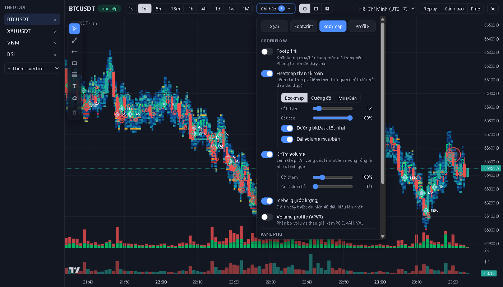
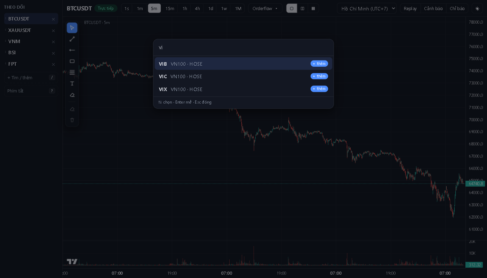
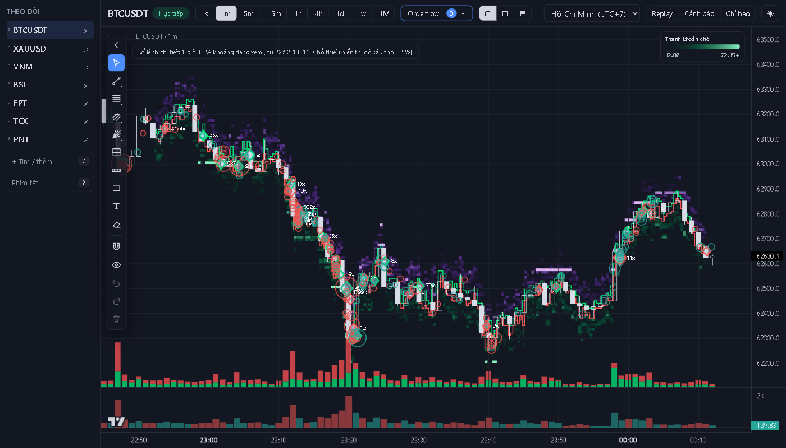
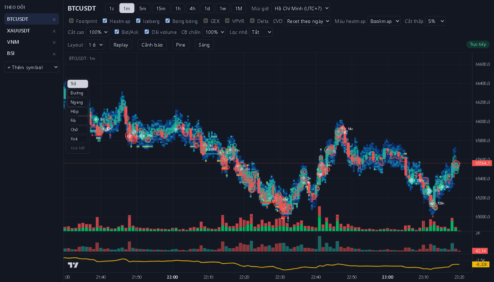
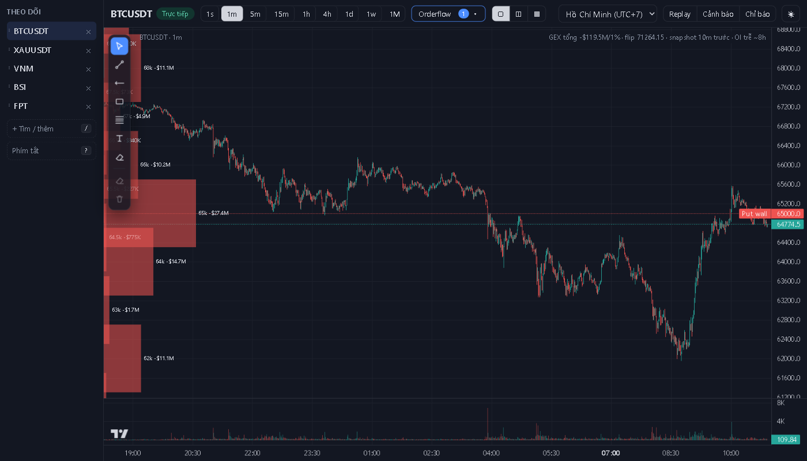
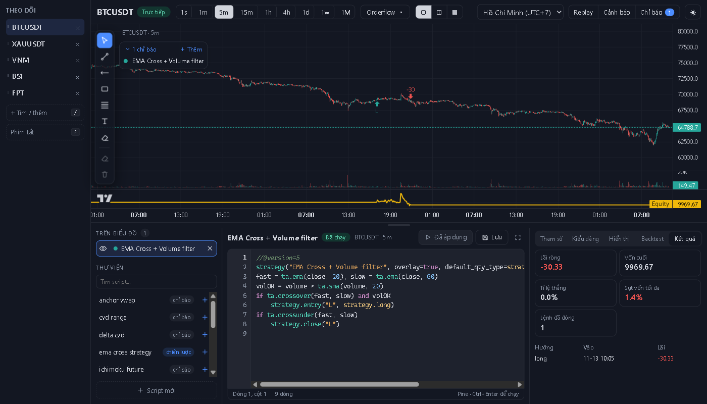
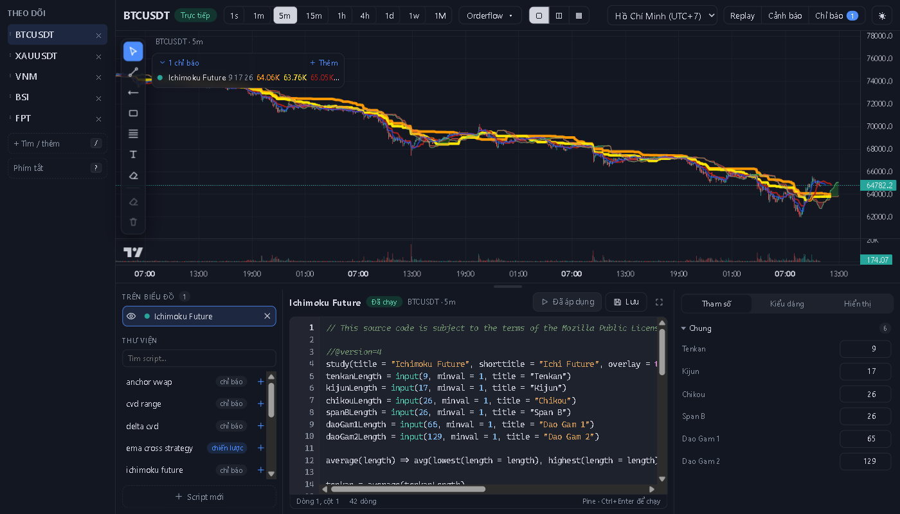
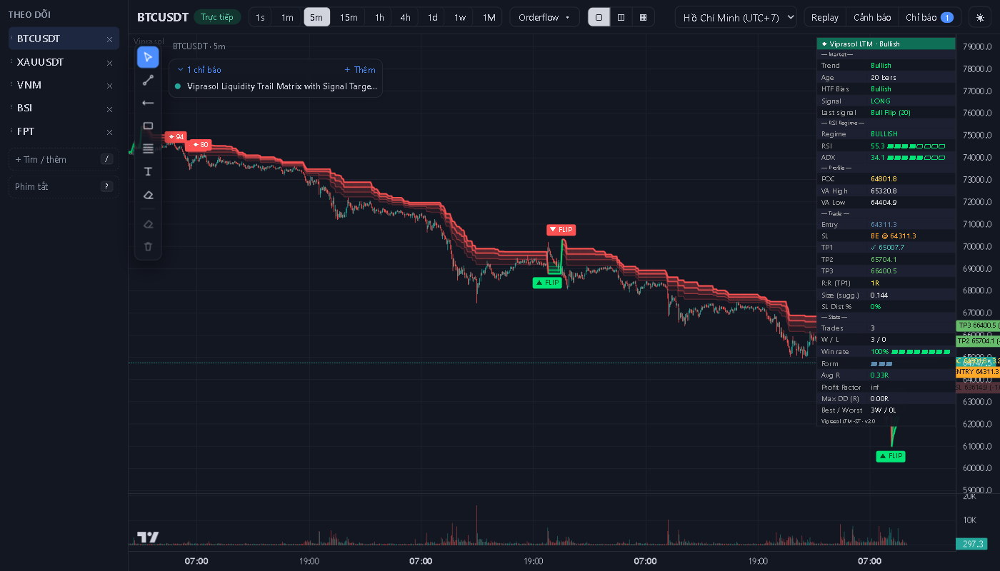

# TradingView

Biểu đồ giá chạy trên máy cá nhân, dùng một người, lấy cảm hứng từ TradingView. Mục tiêu: nến, volume, orderflow (footprint, delta, CVD), heatmap thanh khoản và GEX cho BTC và vàng, cộng volume cổ phiếu VN100. Script Pine (v4 đến v6, một tập con lớn) chạy trên dữ liệu của bạn, có backtest, cảnh báo nền và phát lại nến.

Dự án không liên kết với TradingView. Không dùng tên, logo hay giao diện của họ.

## Trạng thái

| Phase | Nội dung | Trạng thái |
|---|---|---|
| 0 | Khung dự án, kho Parquet, server, trang web | Xong |
| 1 | Collector BTC và vàng (Binance Futures): nến, backfill, tick trực tiếp, sổ lệnh, gom nén | Xong. Đã đo sổ lệnh 1 giờ (xem `docs/plan/engineering-notes.md`) |
| 2 | Chart: nến, volume, danh sách theo dõi (kéo thả), trực tiếp, múi giờ, giao diện sáng/tối, khung `1s` đến `1M` | Xong |
| 3 | Orderflow: footprint (4 kiểu, imbalance, POC, stacked imbalance), delta, CVD, VPVR | Xong, trừ volume profile theo phiên |
| 4 | Heatmap thanh khoản kiểu DeepCharts và Bookmap, chấm lệnh lớn, iceberg ước lượng | Xong, chưa đo thời gian vẽ (đích 100 ms) |
| 5 | GEX BTC (Deribit): snapshot 15 phút, GEX theo strike, gamma flip, call/put wall | Xong. Gamma tính từ IV (Black-76), OI trễ ~8 giờ |
| 6 | Vàng (XAUUSDT; GC1! tuỳ chọn, trả phí) | 6A xong. 6B và 6C chưa làm (tuỳ chọn) |
| 7 | Cổ phiếu VN100 (SSI iBoard và VNDirect, không cần khoá) | Danh sách, nến 1 phút (khoảng 270 ngày) và bộ ghi sổ lệnh 3 mức xong. **Chưa đo phiên giao dịch thật** (Thứ Hai 16/11) |
| 8 | Engine Pine: parser, thông dịch, `ta.*`, `request.security` và `security_lower_tf`, `type`, `import` (shim thư viện), mảng, line/label/box/table/polyline | Xong. Chạy được 6 script thật, 4 có đối chiếu tham chiếu độc lập |
| 9 | Công cụ vẽ, layout 1/2/4 ô, cảnh báo nền (desktop, Telegram), phát lại, backtest | Xong (xem giới hạn trong `docs/plan/engineering-notes.md`) |
| UX | Chỉ báo Pine nhiều cái cùng lúc, bảng Orderflow, tìm symbol, phím tắt, giao diện điện thoại | Xong |

Kế hoạch, điều kiện nghiệm thu, số đo và việc còn mở của từng tính năng nằm trong [`docs/plan/`](docs/plan/README.md), mỗi tính năng một file. Đặc tả gốc và bản nghiên cứu đầu tiên nằm trong `docs/plan/archive/`.

Sơ đồ tương tác của kế hoạch: mở `docs/plan/plan.html` bằng trình duyệt. Trang chạy offline. Dựng lại bằng `cd plan-viewer && npm install && node build.mjs`.

Việc còn mở và thứ tự ưu tiên: xem [`TODO.md`](TODO.md). Kế hoạch từng tính năng: [`docs/plan/README.md`](docs/plan/README.md). Lịch sử thay đổi: [`CHANGELOG.md`](CHANGELOG.md).

## Giao diện

Thanh trên cùng chỉ có một hàng: symbol và trạng thái trực tiếp, khung thời gian, nút **Chỉ báo**, bố cục 1/2/4 ô, múi giờ, Replay, Cảnh báo, Pine, đổi sáng/tối. Mọi tính năng orderflow nằm trong bảng **Chỉ báo**: có 4 mẫu dựng sẵn (Sạch, Footprint, Bookmap, Profile), công tắc có mô tả một dòng, thanh trượt cho ngưỡng cắt, cỡ chấm, imbalance; tuỳ chọn chi tiết chỉ hiện khi bật tính năng; tính năng không dùng được cho symbol hiện tại (ví dụ cổ phiếu VN không có tick) bị làm mờ kèm giải thích. Bảng đóng bằng Esc hoặc bấm ra ngoài. Thanh vẽ ở mép trái dùng biểu tượng kèm gợi ý khi rê chuột; trên điện thoại thanh này nằm ngang và các nút tự gọn lại.



**Tìm symbol và phím tắt**: bấm `/` hoặc `Ctrl+K` để tìm theo mã (gõ một phần là lọc, mũi tên chọn, Enter mở; mã chưa theo dõi sẽ được thêm). `[` và `]` đổi khung thời gian, `T` đổi sáng/tối, `?` xem danh sách phím, `Ctrl+Enter` chạy script Pine, `Esc` đóng bảng.



Ảnh chụp từ bản chạy thật, dữ liệu thật của máy này (2026-11-14 và 2026-11-15). Chế độ tối là mặc định theo hệ thống; có nút đổi sang sáng.

Phần orderflow bám theo thiết kế của [DeepCharts](https://www.deepcharts.com) (Deep Print, DeepDom, Deep Trades), dựa trên tài liệu công khai của họ: thang màu heatmap, kiểu footprint, ký hiệu lệnh lớn. Dữ liệu và công thức là của dự án này, không sao chép mã hay tài sản của DeepCharts.

**Footprint** (BTCUSDT 1 phút), kiểu Bid x Ask: ô `bán x mua` theo từng mức giá, màu theo imbalance chéo (ngưỡng 2:1 đến 5:1), viền vàng là POC, vạch đậm ở mép nến là stacked imbalance (từ 3 mức liên tiếp), dòng `Δ` và `V` dưới mỗi nến cho delta và volume của cả nến. Chữ co theo chiều cao ô. Có thêm kiểu Delta, Volume và Profile.


Kiểu **Profile**: thanh ngang hai phía từ tâm nến, dài theo khối lượng bán (trái) và mua (phải).


**Heatmap thanh khoản** dưới nến, thang cường độ như DeepDom: đen, xanh dương, trắng, vàng, cam, đỏ (nhiều nhất), chuẩn hoá theo phân vị 99 của đoạn đang xem nên tự co giãn theo thị trường. Kèm bong bóng lệnh lớn kiểu Deep Trades: vòng đặc là một lệnh lớn đơn lẻ, vòng rỗng là nhiều lệnh nhỏ cộng lại; xanh là mua chủ động, đỏ là bán chủ động.


Kiểu màu **Mua/Bán**: lệnh mua chờ màu xanh lá, lệnh bán chờ màu tím.



**Kiểu Bookmap** (mặc định): thang màu nền đen, xanh đậm, xanh dương, cyan, vàng, cam, đỏ; chỉnh được ngưỡng cắt thấp và cao của thang; đường bid và ask tốt nhất dạng bậc thang (xanh lá và đỏ); dải volume mua/bán dưới đáy vùng giá; chấm volume có thanh trượt cỡ và bộ lọc lệnh nhỏ; hình thoi băng giá là dấu hiệu iceberg ước lượng (số bên cạnh là tỉ lệ khối lượng khớp so với thanh khoản hiển thị, độ tin cậy thấp).



**GEX BTC** từ options Deribit: histogram theo strike, gamma flip, call wall, put wall, kèm nhãn tuổi dữ liệu và OI trễ.



**Pine Script và backtest**: editor, tham số tự sinh, vốn, phí, trượt giá, khoảng ngày, đường vốn và danh sách lệnh.



**Nhiều chỉ báo Pine cùng lúc**: nút **Chỉ báo** (phím `I`) mở bảng quản lý. Bên trái là danh sách đang dùng (ẩn/hiện, xoá) và Thư viện có ô tìm, thêm một chạm; giữa là trình soạn mã; bên phải là tham số tự sinh từ script (nhóm theo `group`, thanh trượt khi có min/max, ô tìm khi có nhiều tham số), backtest và thống kê. Trên biểu đồ có chú giải chỉ báo (ẩn/hiện, cài đặt nhanh, sửa mã, xoá). Danh sách chỉ báo, tham số và script của bạn (Lưu vào thư viện) nhớ trong trình duyệt; đổi symbol hoặc khung thì mọi chỉ báo đang hiện tự chạy lại.



**Ichimoku Future, Volume Profile Total và Institutional Level (SMC)**: ba script Pine thật chạy trên engine; mây Ichimoku dịch về tương lai, volume profile nằm ở lề phải, order block cùng nhãn cấu trúc thị trường.


**Script Pine thật dài 1720 dòng** (Viprasol Liquidity Trail Matrix, Pine v6): băng trail, nhãn đảo chiều, tín hiệu retest, đường entry/SL/TP, volume profile của đoạn xu hướng và bảng dashboard, chạy trên engine của dự án.



**Layout 4 ô** (chế độ sáng): BTCUSDT, XAUUSDT và hai cổ phiếu VN100 (VNM, BSI), cuộn và crosshair đồng bộ theo thời gian.


Chụp lại ảnh sau khi đổi giao diện: mở trang ở 1400x800, bật tính năng cần chụp rồi lưu vào `docs/screenshots/`.

## Nguồn dữ liệu

| Dữ liệu | Nguồn | Chi phí |
|---|---|---|
| BTC: nến, lệnh khớp, sổ lệnh | Binance Futures (API công khai, không cần key) | Miễn phí |
| BTC: GEX | Deribit (open interest trễ 8 giờ) | Miễn phí |
| Vàng: orderflow, heatmap | Binance XAUUSDT (hợp đồng perpetual, lịch sử từ 11/12/2025; cuối tuần vẫn khớp lệnh) | Miễn phí |
| Vàng: volume COMEX, options | Databento (GC1!) | Trả phí, chưa làm |
| VN100: danh sách, bảng giá 3 mức | SSI iBoard (endpoint công khai, không có tài liệu chính thức) | Miễn phí |
| VN100: nến 1 phút, khoảng 270 ngày | VNDirect dchart (cũng không chính thức) | Miễn phí |

Hai nguồn VN không có hợp đồng sử dụng; có thể đổi định dạng hoặc bị chặn bất cứ lúc nào, chỉ nên dùng cá nhân và gọi thưa. Cổ phiếu VN không có tick, chỉ có nến từ 1 phút và snapshot sổ lệnh 3 mức.

Lịch sử sổ lệnh từng mức giá không có miễn phí. Collector phải ghi từ lúc bạn bắt đầu chạy. Bảng đầy đủ, kèm giá và giới hạn, nằm trong kế hoạch.

## Cài đặt (Windows)

Cần Python 3.11 trở lên (đã chạy trên 3.15.2) và Node.js (đã chạy trên 26.13).

1. Sao chép `.env.example` thành `.env`. Đặt `DATA_DIR` **ngoài OneDrive**, ví dụ `C:\tv-data`. Code từ chối đường dẫn nằm trong OneDrive, vì OneDrive sẽ đồng bộ hàng nghìn file dữ liệu và khoá file khi ghi.
2. Tạo môi trường Python trong `DATA_DIR` và cài thư viện:
   ```powershell
   python -m venv C:\tv-data\.venv
   C:\tv-data\.venv\Scripts\python.exe -m pip install fastapi uvicorn duckdb httpx websockets python-dotenv pytest
   ```
   Không dùng `uvicorn[standard]`: nó kéo theo PyYAML, chưa có bản dựng sẵn cho Python 3.15.
3. Tạo thư mục dữ liệu và `app.sqlite`:
   ```powershell
   C:\tv-data\.venv\Scripts\python.exe -m common.init_data
   ```
4. Cài thư viện web ngoài OneDrive (script tạo junction `web\node_modules`):
   ```powershell
   .\scripts\web-deps.ps1
   ```
   Luôn thêm gói qua script này (`-Add 'tên-gói'`). `npm install` chạy thẳng trong `web\` sẽ xoá junction và cài vào OneDrive.

## Chạy

```powershell
.\dev.ps1
```

Mở `http://localhost:5173`. `dev.ps1` chạy server Python (`127.0.0.1:8000`) và Vite; nhấn Ctrl+C để dừng cả hai. Server không tự nạp lại khi bạn sửa mã Python, nên sau khi sửa phải khởi động lại `dev.ps1`.

Chạy test (khoảng 240 test Python, mất 1,5 phút; test cần mạng được bỏ qua mặc định):
```powershell
C:\tv-data\.venv\Scripts\python.exe -m pytest
cd web; npx tsc --noEmit; node --test src/
```

## Thu thập dữ liệu

Đặt `$py = 'C:\tv-data\.venv\Scripts\python.exe'` (hoặc đường dẫn venv của bạn), chạy từ thư mục dự án.

| Việc | Lệnh |
|---|---|
| Nến 1 phút 30 ngày gần nhất | `& $py -m collector.klines --symbol BTCUSDT --days 30` |
| Lịch sử tick (kiểm checksum) | `& $py -m collector.backfill --symbol BTCUSDT --dataset aggTrades --days 30` |
| Lịch sử độ sâu thô, open interest | `--dataset bookDepth` hoặc `--dataset metrics` |
| Kiểm tra nến dựng từ tick so với kline | `& $py -m collector.verify --symbol BTCUSDT --days 3` |
| Tick trực tiếp | `& $py -m collector.live_trades --symbols BTCUSDT,XAUUSDT` |
| Sổ lệnh trực tiếp (heatmap) | `& $py -m collector.live_book --symbols BTCUSDT,XAUUSDT` |
| Gom nén (thử trước) | `& $py -m collector.compact --dry-run` |
| Việc hằng đêm: nến, sửa khoảng thiếu, gom nén (thêm `--vn` để cập nhật nến VN100) | `& $py -m collector.daily` |
| Snapshot quyền chọn Deribit, mỗi 15 phút (GEX) | `& $py -m collector.deribit` |
| Cảnh báo nền (giá, cắt mức, `alertcondition` của Pine; gửi toast Windows và Telegram) | `& $py -m collector.alerts` |
| Gộp file con của ngày hôm nay mỗi 30 phút (truy vấn nhanh lại) | `& $py -m collector.hotmerge` (hoặc một lần: `-m collector.compact --hot`) |
| Danh sách VN100 từ SSI | `& $py -m collector.vn refresh-vn100` |
| Nến 1 phút VN100 (nạp lần đầu mất khoảng 1,5 giờ cho 100 mã) | `& $py -m collector.vn bars` |
| Sổ lệnh VN100, tự chỉ ghi trong giờ giao dịch HOSE | `& $py -m collector.vn_book` |

**Collector trực tiếp chỉ chạy khi tiến trình còn sống.** Đóng cửa sổ, tắt máy hoặc kết thúc phiên làm việc là chúng dừng, và dữ liệu sổ lệnh trong quá khứ không lấy lại được miễn phí. Muốn chạy liên tục, dùng:

```powershell
.\scripts\run-collectors.ps1
```

Script khởi động mọi tiến trình nền (tick, sổ lệnh, Deribit, cảnh báo, gộp nóng, sổ lệnh VN100), tự chạy lại nếu một cái thoát, ghi log vào `DATA_DIR\logs`. Cảnh báo chỉ bắn khi tiến trình `collector.alerts` còn sống, kể cả khi đã đóng trình duyệt. Đừng chạy hai bộ collector cùng lúc: hai bên sẽ ghi trùng.

Hai việc cần lên lịch (chạy một lần, đổi đường dẫn cho đúng):

```powershell
$root = 'C:\duong\dan\toi\TradingView'
schtasks /Create /TN tv-collectors /SC ONLOGON /TR "powershell -NoProfile -ExecutionPolicy Bypass -File $root\scripts\run-collectors.ps1"
schtasks /Create /TN tv-daily /SC DAILY /ST 03:00 /TR "cmd /c cd /d $root && C:\tv-data\.venv\Scripts\python.exe -m collector.daily"
```

`collector.daily` là việc không thể thiếu, không chỉ là dọn dẹp. Với mỗi symbol nó chạy: (1) đồng bộ nến 1 phút (không có bước này `bars` đứng yên), (2) tải lại 3 ngày gần nhất từ kho Binance để sửa mọi khoảng thiếu của collector trực tiếp (máy tắt, khoảng hở bị bỏ qua), (3) gom nén. 03:00 giờ Việt Nam là 20:00 UTC, lúc đó file của ngày UTC hôm kia đã được Binance công bố. Mỗi bước bọc riêng, mã thoát khác 0 nếu có bước lỗi.

Gom nén chỉ đụng các ngày đã qua. Tick quá 30 ngày được gom thành footprint 1 phút (chỉ bằng khoảng 6% dung lượng) sau khi kiểm tra tổng mua và bán từng phút. Chính sách nằm trong `config/retention.toml`.

Ghi chú kỹ thuật, số đo và các quyết định đã đổi so với kế hoạch: [`docs/plan/engineering-notes.md`](docs/plan/engineering-notes.md).

## Cấu trúc

```
common/      kho Parquet (store.py), SQLite (appdb.py), nến (bars.py), GEX (gex.py), khởi tạo thư mục
collector/   thu thập và việc nền: binance, klines, backfill, live_trades, live_book, deribit, vn, vn_book,
             compact, hotmerge, daily, alerts, verify
server/      FastAPI: bars, footprint, heatmap (cả bubbles, icebergs, profile), gex, pine, drawings, alerts,
             watchlist, live_hub (WebSocket)
pine/        engine Pine: lexer, parser, interp, ta, objects (mảng, chuỗi, line/label/box/table), runner; examples/ là script mẫu
web/         Vite + React + TypeScript + Lightweight Charts
config/      symbols.toml (tick size), vn100.json (danh sách VN100 kèm ngày lấy), retention.toml (chính sách giữ dữ liệu)
tests/       pytest (có đối chiếu độc lập cho chỉ báo, backtest, footprint, profile, GEX)
docs/        plan/ (kế hoạch theo từng tính năng, sơ đồ tương tác), screenshots/ (ảnh dùng trong README)
scripts/     web-deps.ps1, run-collectors.ps1, ...
plan-viewer/ sơ đồ tương tác của kế hoạch
```

Dữ liệu nằm ngoài repo, trong `DATA_DIR`, dạng Parquet nén zstd theo `kind/symbol/date=YYYY-MM-DD.parquet`, đọc bằng DuckDB. Một ngày BTCUSDT khoảng 6,65 MB. Ước tính dung lượng dài hạn và chính sách gom nén nằm trong kế hoạch.

## Lưu ý

- File `.ps1` phải giữ ASCII thuần. Windows PowerShell 5.1 đọc UTF-8 không BOM theo bảng mã ANSI và làm hỏng chuỗi tiếng Việt.
- Lightweight Charts theo giấy phép Apache-2.0 và yêu cầu ghi attribution.
- Mỗi nguồn dữ liệu có điều khoản riêng. Dùng cá nhân. Đọc điều khoản trước khi chia sẻ dữ liệu hoặc công bố kết quả.
- Engine Pine là một tập con tự viết, chưa đối chiếu với TradingView; script chạy được chưa có nghĩa là kết quả giống TradingView. Giới hạn nằm trong `docs/plan/08-pine-engine.md`.
- Đây không phải lời khuyên đầu tư. Orderflow, heatmap và GEX là mô hình ước tính với giả định riêng. Xem giới hạn trong kế hoạch.
