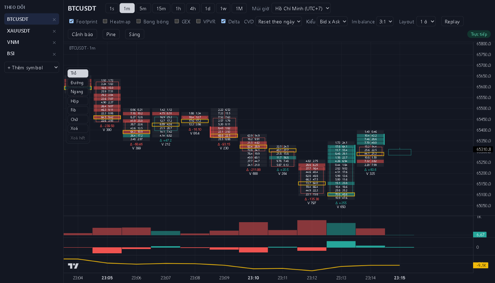
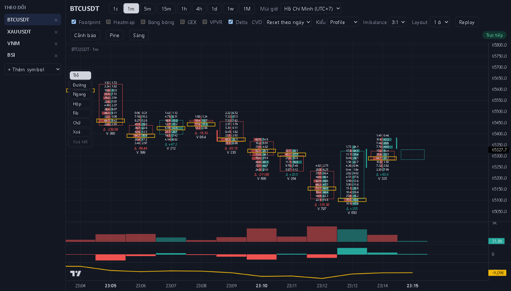
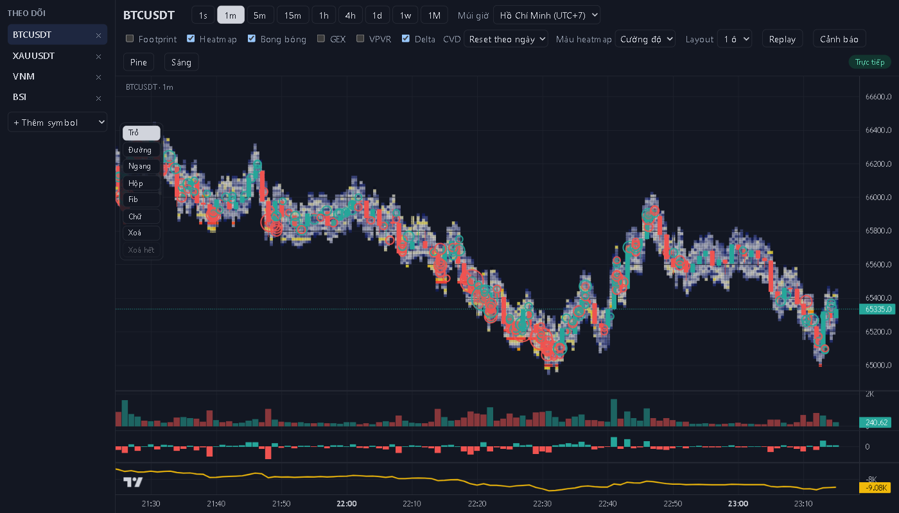
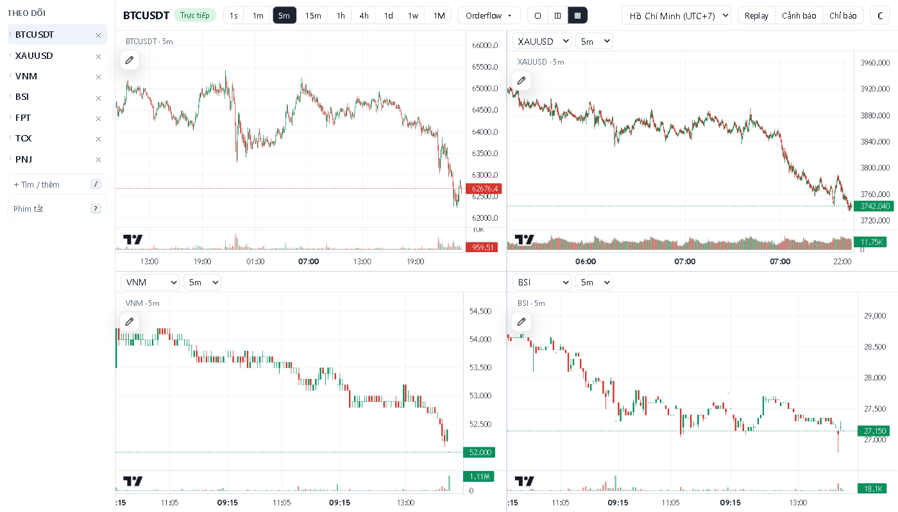

# TradingView

Biểu đồ giá chạy trên máy cá nhân, dùng một người, lấy cảm hứng từ TradingView. Mục tiêu: nến, volume, orderflow (footprint, delta, CVD), heatmap thanh khoản và GEX cho BTC và vàng, cộng volume cổ phiếu VN100. Script Pine chạy trên dữ liệu của bạn.

Dự án không liên kết với TradingView. Không dùng tên, logo hay giao diện của họ.

## Trạng thái

| Phase | Nội dung | Trạng thái |
|---|---|---|
| 0 | Khung dự án, kho Parquet, server, trang web | Xong |
| 1 | Collector BTC và vàng (Binance Futures): nến, backfill, tick trực tiếp, sổ lệnh, gom nén | Xong. Đã đo sổ lệnh 1 giờ (xem `NOTES.md`) |
| 2 | Chart cơ bản: nến, volume, danh sách theo dõi, trực tiếp, múi giờ, giao diện tối | Xong |
| 3 | Orderflow: footprint (imbalance, POC), delta, CVD, VPVR (POC/VAH/VAL) | Xong, trừ volume profile theo phiên |
| 4 | Heatmap thanh khoản: lớp heatmap dưới nến, bong bóng lệnh lớn | Xong, chưa đo thời gian vẽ (đích 100 ms) |
| 5 | GEX BTC (Deribit): snapshot 15 phút, GEX theo strike, gamma flip, call/put wall | Xong. Gamma tính từ IV (Black-76), OI trễ ~8 giờ |
| 6 | Vàng (XAUUSDT; GC1! tuỳ chọn, trả phí) | 6A xong (nến, footprint, heatmap, ghi chú nguồn). 6B và 6C chưa làm (tuỳ chọn) |
| 7 | Cổ phiếu VN100 | Đang làm: danh sách, nến 1 phút (nạp nền), bộ ghi sổ lệnh 3 mức. Chưa đo được phiên thật (thứ Hai 16/11) |
| 8 | Engine Pine Script (tập con): parser, thông dịch, ta.*, request.security/external, strategy, 5 script mẫu, panel trong web | Xong (editor là ô văn bản, chưa Monaco) |
| 9 | Công cụ vẽ, layout, alert, replay, backtest | Xong (xem giới hạn trong `NOTES.md`) |

Kế hoạch chi tiết, điều kiện nghiệm thu từng phase và các việc chưa xác minh nằm trong [`PLAN-CLAUDE-CODE.md`](PLAN-CLAUDE-CODE.md). Bản nghiên cứu đầu tiên là [`PLAN.md`](PLAN.md). Một số nhận định trong đó đã được sửa, xem ghi chú đầu file.

Sơ đồ tương tác của kế hoạch: mở `plan-viewer/dist/plan.html` bằng trình duyệt. Trang chạy offline. Dựng lại bằng `cd plan-viewer && npm install && node build.mjs`.

## Giao diện

Ảnh chụp từ bản chạy thật, dữ liệu thật của máy này (2026-11-14). Chế độ tối là mặc định theo hệ thống; có nút đổi sang sáng.

Phần orderflow bám theo thiết kế của [DeepCharts](https://www.deepcharts.com) (Deep Print, DeepDom, Deep Trades), dựa trên tài liệu công khai của họ: thang màu heatmap, kiểu footprint, ký hiệu lệnh lớn. Dữ liệu và công thức là của dự án này, không sao chép mã hay tài sản của DeepCharts.

**Footprint** (BTCUSDT 1 phút), kiểu Bid x Ask: ô `bán x mua` theo từng mức giá, màu theo imbalance chéo (ngưỡng 2:1 đến 5:1), viền vàng là POC, vạch đậm ở mép nến là stacked imbalance (từ 3 mức liên tiếp), dòng `Δ` và `V` dưới mỗi nến cho delta và volume của cả nến. Chữ co theo chiều cao ô. Có thêm kiểu Delta, Volume và Profile.



Kiểu **Profile**: thanh ngang hai phía từ tâm nến, dài theo khối lượng bán (trái) và mua (phải).



**Heatmap thanh khoản** dưới nến, thang cường độ như DeepDom: đen, xanh dương, trắng, vàng, cam, đỏ (nhiều nhất), chuẩn hoá theo phân vị 99 của đoạn đang xem nên tự co giãn theo thị trường. Kèm bong bóng lệnh lớn kiểu Deep Trades: vòng đặc là một lệnh lớn đơn lẻ, vòng rỗng là nhiều lệnh nhỏ cộng lại; xanh là mua chủ động, đỏ là bán chủ động.



Kiểu màu **Mua/Bán**: lệnh mua chờ màu xanh lá, lệnh bán chờ màu tím.


**GEX BTC** từ options Deribit: histogram theo strike, gamma flip, call wall, put wall, kèm nhãn tuổi dữ liệu và OI trễ.


**Pine Script và backtest**: editor, tham số tự sinh, vốn, phí, trượt giá, khoảng ngày, đường vốn và danh sách lệnh.


**Layout 4 ô** (chế độ sáng): BTCUSDT, XAUUSDT và hai cổ phiếu VN100 (VNM, BSI), cuộn và crosshair đồng bộ theo thời gian.



Chụp lại ảnh sau khi đổi giao diện: mở trang ở 1400x800, bật tính năng cần chụp rồi lưu vào `docs/screenshots/`.

## Nguồn dữ liệu

| Dữ liệu | Nguồn | Chi phí |
|---|---|---|
| BTC: nến, lệnh khớp, sổ lệnh | Binance Futures (API công khai, không cần key) | Miễn phí |
| BTC: GEX | Deribit (open interest trễ 8 giờ) | Miễn phí |
| Vàng: orderflow, heatmap | Binance XAUUSDT, lịch sử từ 11/12/2025 | Miễn phí |
| Vàng: volume COMEX, options | Databento (GC1!) | Trả phí |
| Cổ phiếu VN100 | vnstock, SSI FastConnect (cần tài khoản SSI) | Miễn phí hoặc chưa rõ |

Lịch sử sổ lệnh từng mức giá không có miễn phí. Collector phải ghi từ lúc bạn bắt đầu chạy. Bảng đầy đủ, kèm giá và giới hạn, nằm trong kế hoạch.

## Cài đặt (Windows)

Cần Python 3.11 trở lên (đã chạy trên 3.15.2) và Node.js (đã chạy trên 26.13).

1. Sao chép `.env.example` thành `.env`. Đặt `DATA_DIR` **ngoài OneDrive**, ví dụ `C:\tv-data`. Code từ chối đường dẫn nằm trong OneDrive, vì OneDrive sẽ đồng bộ hàng nghìn file dữ liệu và khoá file khi ghi.
2. Tạo môi trường Python trong `DATA_DIR` và cài thư viện:
   ```powershell
   python -m venv C:\tv-data\.venv
   C:\tv-data\.venv\Scripts\python.exe -m pip install fastapi uvicorn duckdb httpx websockets python-dotenv pytest
   ```
   Không dùng `uvicorn[standard]`: nó kéo theo PyYAML, chưa có bản dựng sẵn cho Python 3.15.
3. Tạo thư mục dữ liệu và `app.sqlite`:
   ```powershell
   C:\tv-data\.venv\Scripts\python.exe -m common.init_data
   ```
4. Cài thư viện web ngoài OneDrive (script tạo junction `web\node_modules`):
   ```powershell
   .\scripts\web-deps.ps1
   ```
   Luôn thêm gói qua script này (`-Add 'tên-gói'`). `npm install` chạy thẳng trong `web\` sẽ xoá junction và cài vào OneDrive.

## Chạy

```powershell
.\dev.ps1
```

Mở `http://localhost:5173`. Trang hiện "server OK" khi server Python (`127.0.0.1:8000`) hoạt động. Nhấn Ctrl+C để dừng cả hai.

Chạy test:
```powershell
C:\tv-data\.venv\Scripts\python.exe -m pytest
```

## Thu thập dữ liệu

Đặt `$py = 'C:\tv-data\.venv\Scripts\python.exe'` (hoặc đường dẫn venv của bạn), chạy từ thư mục dự án.

| Việc | Lệnh |
|---|---|
| Nến 1 phút 30 ngày gần nhất | `& $py -m collector.klines --symbol BTCUSDT --days 30` |
| Lịch sử tick (kiểm checksum) | `& $py -m collector.backfill --symbol BTCUSDT --dataset aggTrades --days 30` |
| Lịch sử độ sâu thô, open interest | `--dataset bookDepth` hoặc `--dataset metrics` |
| Kiểm tra nến dựng từ tick so với kline | `& $py -m collector.verify --symbol BTCUSDT --days 3` |
| Tick trực tiếp | `& $py -m collector.live_trades --symbols BTCUSDT,XAUUSDT` |
| Sổ lệnh trực tiếp (heatmap) | `& $py -m collector.live_book --symbols BTCUSDT,XAUUSDT` |
| Gom nén (thử trước) | `& $py -m collector.compact --dry-run` |
| Việc hằng đêm: nến, sửa khoảng thiếu, gom nén | `& $py -m collector.daily` |

**Collector trực tiếp chỉ chạy khi tiến trình còn sống.** Đóng cửa sổ, tắt máy hoặc kết thúc phiên làm việc là chúng dừng, và dữ liệu sổ lệnh trong quá khứ không lấy lại được miễn phí. Muốn chạy liên tục, dùng:

```powershell
.\scripts\run-collectors.ps1
```

Script khởi động cả hai collector, tự chạy lại nếu một cái thoát, ghi log vào `DATA_DIR\logs`. Đừng chạy hai bộ collector cùng lúc: hai bên sẽ ghi trùng.

Hai việc cần lên lịch (chạy một lần, đổi đường dẫn cho đúng):

```powershell
$root = 'C:\duong\dan\toi\TradingView'
schtasks /Create /TN tv-collectors /SC ONLOGON /TR "powershell -NoProfile -ExecutionPolicy Bypass -File $root\scripts\run-collectors.ps1"
schtasks /Create /TN tv-daily /SC DAILY /ST 03:00 /TR "cmd /c cd /d $root && C:\tv-data\.venv\Scripts\python.exe -m collector.daily"
```

`collector.daily` là việc không thể thiếu, không chỉ là dọn dẹp. Với mỗi symbol nó chạy: (1) đồng bộ nến 1 phút (không có bước này `bars` đứng yên), (2) tải lại 3 ngày gần nhất từ kho Binance để sửa mọi khoảng thiếu của collector trực tiếp (máy tắt, khoảng hở bị bỏ qua), (3) gom nén. 03:00 giờ Việt Nam là 20:00 UTC, lúc đó file của ngày UTC hôm kia đã được Binance công bố. Mỗi bước bọc riêng, mã thoát khác 0 nếu có bước lỗi.

Gom nén chỉ đụng các ngày đã qua. Tick quá 30 ngày được gom thành footprint 1 phút (chỉ bằng khoảng 6% dung lượng) sau khi kiểm tra tổng mua và bán từng phút. Chính sách nằm trong `config/retention.toml`.

Ghi chú kỹ thuật, số đo và các quyết định đã đổi so với kế hoạch: [`NOTES.md`](NOTES.md).

## Cấu trúc

```
common/      kho Parquet (store.py), SQLite (appdb.py), khởi tạo thư mục
collector/   thu thập: binance.py, klines.py, backfill.py, live_trades.py, live_book.py, verify.py, compact.py
server/      FastAPI: /health, sau này /bars, /footprint, /heatmap, /gex
web/         Vite + React + TypeScript + Lightweight Charts
config/      symbols.toml (tick size), retention.toml (chính sách giữ dữ liệu)
tests/       pytest
scripts/     web-deps.ps1, run-collectors.ps1, ...
plan-viewer/ sơ đồ tương tác của kế hoạch
```

Dữ liệu nằm ngoài repo, trong `DATA_DIR`, dạng Parquet nén zstd theo `kind/symbol/date=YYYY-MM-DD.parquet`, đọc bằng DuckDB. Một ngày BTCUSDT khoảng 6,65 MB. Ước tính dung lượng dài hạn và chính sách gom nén nằm trong kế hoạch.

## Lưu ý

- File `.ps1` phải giữ ASCII thuần. Windows PowerShell 5.1 đọc UTF-8 không BOM theo bảng mã ANSI và làm hỏng chuỗi tiếng Việt.
- Lightweight Charts theo giấy phép Apache-2.0 và yêu cầu ghi attribution.
- Mỗi nguồn dữ liệu có điều khoản riêng. Dùng cá nhân. Đọc điều khoản trước khi chia sẻ dữ liệu hoặc công bố kết quả.
- Đây không phải lời khuyên đầu tư. Orderflow, heatmap và GEX là mô hình ước tính với giả định riêng. Xem giới hạn trong kế hoạch.
