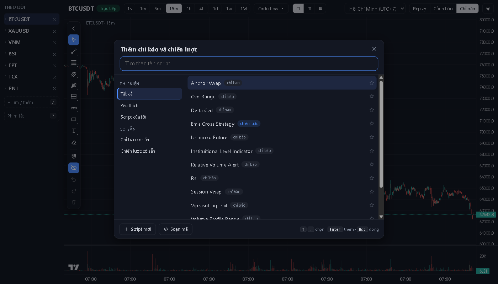
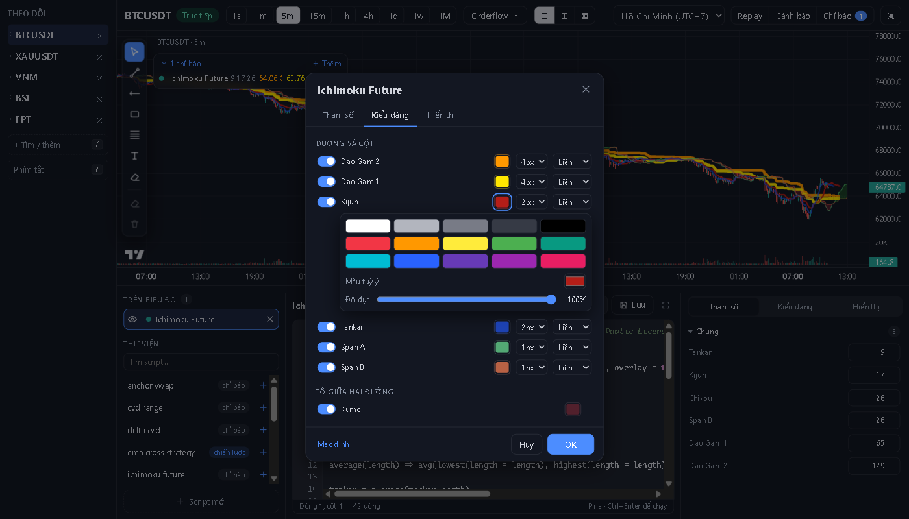
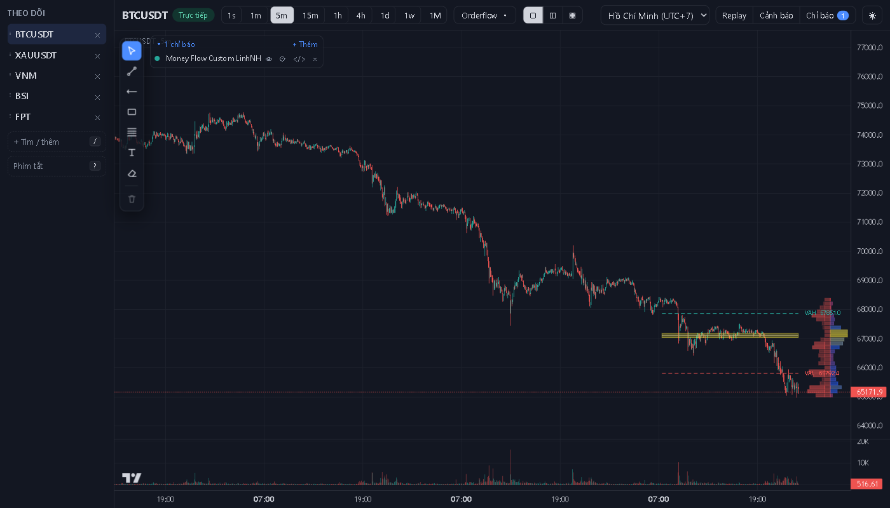
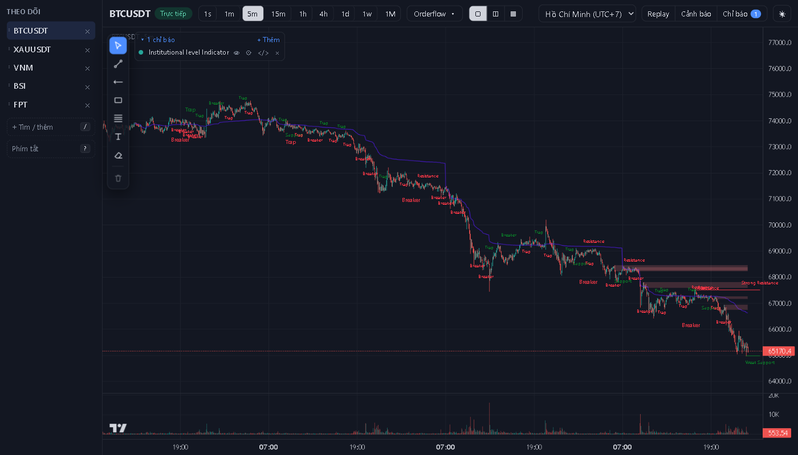
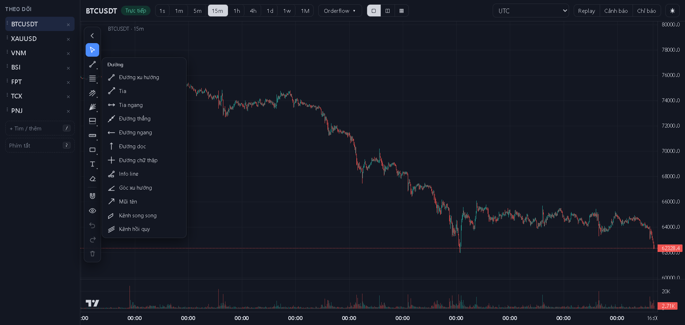
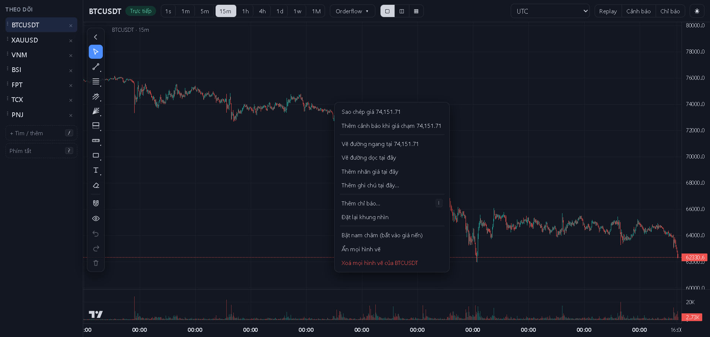

# TradingView

Biểu đồ giá chạy trên máy cá nhân, dùng một người, lấy cảm hứng từ TradingView. Mục tiêu: nến, volume, orderflow (footprint, delta, CVD), heatmap thanh khoản và GEX cho BTC và vàng, cộng volume cổ phiếu VN100. Script Pine (v4 đến v6, một tập con lớn) chạy trên dữ liệu của bạn, có backtest, cảnh báo nền và phát lại nến.

Dự án không liên kết với TradingView. Không dùng tên, logo hay giao diện của họ.

## Trạng thái

| Phase | Nội dung | Trạng thái |
|---|---|---|
| 0 | Khung dự án, kho Parquet, server, trang web | Xong |
| 1 | Collector BTC và vàng (Binance Futures): nến, backfill, tick trực tiếp, sổ lệnh, gom nén | Xong. Đã đo sổ lệnh 1 giờ (xem `docs/plan/engineering-notes.md`) |
| 2 | Chart: nến, volume, danh sách theo dõi (kéo thả), trực tiếp, múi giờ, giao diện sáng/tối, khung `1s` đến `1M` | Xong |
| 3 | Orderflow: footprint (4 kiểu, imbalance, POC, stacked imbalance), delta, CVD, VPVR | Xong, trừ volume profile theo phiên |
| 4 | Heatmap thanh khoản kiểu DeepCharts và Bookmap, chấm lệnh lớn, iceberg ước lượng | Xong, chưa đo thời gian vẽ (đích 100 ms) |
| 5 | GEX BTC (Deribit): snapshot 15 phút, GEX theo strike, gamma flip, call/put wall | Xong. Gamma tính từ IV (Black-76), OI trễ ~8 giờ |
| 6 | Vàng (XAUUSDT; GC1! tuỳ chọn, trả phí) | 6A xong. 6B và 6C chưa làm (tuỳ chọn) |
| 7 | Cổ phiếu VN100 (SSI iBoard và VNDirect, không cần khoá) | Danh sách, nến 1 phút (khoảng 270 ngày, thưa ở giai đoạn cũ), nến ngày từ 2014 và bộ ghi sổ lệnh 3 mức xong. **Chưa đo phiên giao dịch thật** (Thứ Hai 16/11) |
| 8 | Engine Pine: parser, thông dịch, `ta.*`, `request.security` và `security_lower_tf`, `type`, `import` (shim thư viện), mảng, line/label/box/table/polyline | Xong. Chạy được 6 script thật, 4 có đối chiếu tham chiếu độc lập |
| 9 | Công cụ vẽ, layout 1/2/4 ô, cảnh báo nền (desktop, Telegram), phát lại, backtest | Xong (xem giới hạn trong `docs/plan/engineering-notes.md`) |
| UX | Chỉ báo Pine nhiều cái cùng lúc, bảng Orderflow, tìm symbol, phím tắt, giao diện điện thoại | Xong |

Kế hoạch, điều kiện nghiệm thu, số đo và việc còn mở của từng tính năng nằm trong [`docs/plan/`](docs/plan/README.md), mỗi tính năng một file. Đặc tả gốc và bản nghiên cứu đầu tiên nằm trong `docs/plan/archive/`.

Sơ đồ tương tác của kế hoạch: mở `docs/plan/plan.html` bằng trình duyệt. Trang chạy offline. Dựng lại bằng `cd plan-viewer && npm install && node build.mjs`.

Việc còn mở và thứ tự ưu tiên: xem [`TODO.md`](TODO.md). Kế hoạch từng tính năng: [`docs/plan/README.md`](docs/plan/README.md). Lịch sử thay đổi: [`CHANGELOG.md`](CHANGELOG.md).

## Giao diện

Thanh trên cùng chỉ có một hàng: symbol và trạng thái trực tiếp, khung thời gian, nút **Orderflow**, bố cục 1/2/4 ô, múi giờ, Replay, Cảnh báo, **Chỉ báo** (Pine), đổi sáng/tối. Mọi tính năng orderflow nằm trong bảng **Orderflow**: có 4 mẫu dựng sẵn (Sạch, Footprint, Bookmap, Profile), công tắc có mô tả một dòng, thanh trượt cho ngưỡng cắt, cỡ chấm, imbalance; tuỳ chọn chi tiết chỉ hiện khi bật tính năng; tính năng không dùng được cho symbol hiện tại (ví dụ cổ phiếu VN không có tick) bị làm mờ kèm giải thích. Bảng đóng bằng Esc hoặc bấm ra ngoài. Thanh vẽ ở mép trái dùng biểu tượng kèm gợi ý khi rê chuột; trên điện thoại thanh này nằm ngang và các nút tự gọn lại.


**Tìm symbol và phím tắt**: bấm `/` hoặc `Ctrl+K` để tìm theo mã (gõ một phần là lọc, mũi tên chọn, Enter mở; mã chưa theo dõi sẽ được thêm). `[` và `]` đổi khung thời gian, `T` đổi sáng/tối, `I` mở hộp thêm chỉ báo, `?` xem danh sách phím, `Ctrl+Enter` chạy script Pine, `Esc` đóng bảng.


Ảnh chụp từ bản chạy thật, dữ liệu thật của máy này (2026-11-14 và 2026-11-15). Chế độ tối là mặc định theo hệ thống; có nút đổi sang sáng.

Phần orderflow bám theo thiết kế của [DeepCharts](https://www.deepcharts.com) (Deep Print, DeepDom, Deep Trades), dựa trên tài liệu công khai của họ: thang màu heatmap, kiểu footprint, ký hiệu lệnh lớn. Dữ liệu và công thức là của dự án này, không sao chép mã hay tài sản của DeepCharts.

**Footprint** (BTCUSDT 1 phút), kiểu Bid x Ask: ô `bán x mua` theo từng mức giá, màu theo imbalance chéo (ngưỡng 2:1 đến 5:1), viền vàng là POC, vạch đậm ở mép nến là stacked imbalance (từ 3 mức liên tiếp), dòng `Δ` và `V` dưới mỗi nến cho delta và volume của cả nến. Chữ co theo chiều cao ô. Có thêm kiểu Delta, Volume và Profile.


Kiểu **Profile**: thanh ngang hai phía từ tâm nến, dài theo khối lượng bán (trái) và mua (phải).


**Heatmap thanh khoản** dưới nến, thang cường độ như DeepDom: đen, xanh dương, trắng, vàng, cam, đỏ (nhiều nhất), chuẩn hoá theo phân vị 99 của đoạn đang xem nên tự co giãn theo thị trường. Kèm bong bóng lệnh lớn kiểu Deep Trades: vòng đặc là một lệnh lớn đơn lẻ, vòng rỗng là nhiều lệnh nhỏ cộng lại; xanh là mua chủ động, đỏ là bán chủ động.


Kiểu màu **Mua/Bán**: lệnh mua chờ màu xanh lá, lệnh bán chờ màu tím.


**Kiểu Bookmap** (mặc định): thang màu nền đen, xanh đậm, xanh dương, cyan, vàng, cam, đỏ; chỉnh được ngưỡng cắt thấp và cao của thang; đường bid và ask tốt nhất dạng bậc thang (xanh lá và đỏ); dải volume mua/bán dưới đáy vùng giá; chấm volume có thanh trượt cỡ và bộ lọc lệnh nhỏ; hình thoi băng giá là dấu hiệu iceberg ước lượng (số bên cạnh là tỉ lệ khối lượng khớp so với thanh khoản hiển thị, độ tin cậy thấp).


**Bảng độ sâu (DOM)**: cột riêng bên phải trục giá (không đè lên nến), mỗi dòng ứng với một mức giá của biểu đồ (cùng tung độ): ask đỏ ở trên, bid xanh ở dưới, thanh bắt đầu từ mép trái cột và dài theo khối lượng chờ, mọi dòng đều ghi số, dòng bid và ask tốt nhất được tô nền, giá hiện tại có vạch ngang kèm spread. Bảng có hai cột con: **Chờ** (lệnh chờ trong sổ lệnh) và **Khớp**. Cột bên phải là **Khớp**: khối lượng đã khớp ở từng mức giá trong khoảng đang xem (xanh là mua chủ động, đỏ là bán chủ động, mức khớp nhiều nhất có viền vàng), làm mới mỗi 6 giây; XAUUSD dùng lệnh khớp XAUUSDT. Tiêu đề cột ghi độ gom giá, chân cột ghi trạng thái (trực tiếp hay trễ) và độ phủ quanh giá (sổ lệnh Binance chỉ có 1000 mức mỗi phía nên phủ khoảng ±0,3% với BTC). Lấy trực tiếp từ snapshot sổ lệnh của Binance (1000 mức mỗi phía, cập nhật mỗi 2 giây, server nhớ 1,5 giây để nhiều ô dùng chung một yêu cầu); nếu Binance lỗi thì dùng mẫu mới nhất đã ghi và ghi rõ độ trễ. Độ rộng mỗi dòng tự co giãn theo mức thu phóng của trục giá. XAUUSD dùng sổ lệnh XAUUSDT, dịch giá theo chênh lệch.

**Vùng thanh khoản (rút lệnh)**: mỗi lệnh chờ lớn là một thanh ngang kéo dài từ lúc xuất hiện đến lúc biến mất, đúng mức giá của nó. Cuối thanh có dấu hiệu: **✕** là bị rút lệnh, **▶** là bị khớp (có lệnh khớp ở đúng mức giá, phía chủ động đối diện), thanh mờ dần về bên phải là còn hiệu lực. Rê chuột vào thanh để xem phía, khối lượng lớn nhất, giờ bắt đầu và kết thúc, thời gian tồn tại và lý do kết thúc. Thu nhỏ biểu đồ thì chỉ giữ các vùng đủ dài để nhìn thấy (khoảng 6px). Ngưỡng cỡ lệnh chỉnh trong bảng Orderflow.

Cách đọc heatmap cho dễ: thanh khoản thấp mờ dần vào nền (không sáng đều), nến rỗng màu xám khi bật heatmap để không lẫn với dải nhiệt, có chú giải thang màu, rê chuột vào heatmap thì hiện khối lượng bid và ask của ô đang trỏ. Đoạn chưa có sổ lệnh chi tiết (xem mục thu thập dữ liệu) được vẽ bằng độ sâu thô ±5% từ kho `bookDepth` của Binance, kèm ghi chú độ phủ. XAUUSD (vàng spot) không có sổ lệnh nên lấy từ XAUUSDT và dịch giá theo chênh lệch hiện tại, có ghi chú.

**GEX BTC** từ options Deribit: histogram theo strike, gamma flip, call wall, put wall, kèm nhãn tuổi dữ liệu và OI trễ.


**Pine Script và backtest**: editor, tham số tự sinh, vốn, phí, trượt giá, khoảng ngày, đường vốn và danh sách lệnh.


**Thêm chỉ báo**: nút **Chỉ báo** hoặc phím `I` mở hộp thêm chỉ báo. Ô tìm tự focus, phần khớp được tô màu, cột trái phân loại (tất cả, yêu thích, script của tôi, chỉ báo và chiến lược có sẵn). Bấm một dòng hoặc nhấn Enter để thêm, hộp không đóng nên thêm được nhiều chỉ báo liền nhau; dấu ✓ cho biết đã có trên biểu đồ. Ngôi sao ghim script yêu thích.



**Chú giải và cài đặt**: mỗi chỉ báo có một dòng trên biểu đồ với tham số và giá trị cuối tô theo màu đường. Rê chuột để hiện nút ẩn, cài đặt, sửa mã, xoá và menu ⋯ (nhân bản). Nhấp đúp vào tên hoặc bấm bánh răng để mở hộp **Cài đặt** với ba tab: Tham số (tự sinh từ script, nhóm theo `group`, thanh trượt khi có min/max), Kiểu dáng (bật tắt, màu, độ đục, độ dày, nét cho từng đường, mức ngang, tín hiệu và vùng tô) và Hiển thị (chỉ hiện ở những khung nào, nhãn giá trị trên thang giá). Thay đổi áp ngay để xem trước; Huỷ trả về lúc mở hộp, OK giữ lại, Mặc định đặt lại.



**Soạn mã Pine**: nút `</>` trên chú giải hoặc "Soạn mã" trong hộp thêm chỉ báo mở bảng ở dưới biểu đồ. Bên trái là danh sách đang dùng và thư viện, giữa là trình soạn mã có số dòng và dòng lỗi đánh dấu đỏ, bên phải là tham số, kiểu dáng, hiển thị, và với chiến lược thêm tab Backtest và Kết quả. Kéo thanh trên cùng để đổi chiều cao. Danh sách chỉ báo, tham số, kiểu dáng và script của bạn (Lưu vào thư viện) nhớ trong trình duyệt; đổi symbol hoặc khung thì mọi chỉ báo đang hiện tự chạy lại.


**Ichimoku Future, Volume Profile Total và Institutional Level (SMC)**: ba script Pine thật chạy trên engine; mây Ichimoku dịch về tương lai, volume profile nằm ở lề phải, order block cùng nhãn cấu trúc thị trường.




**Script Pine thật dài 1720 dòng** (Viprasol Liquidity Trail Matrix, Pine v6): băng trail, nhãn đảo chiều, tín hiệu retest, đường entry/SL/TP, volume profile của đoạn xu hướng và bảng dashboard, chạy trên engine của dự án.


**Công cụ vẽ.** Thanh công cụ bên trái chia nhóm, bấm mũi tên ▾ để mở danh sách: đường (xu hướng, tia, tia ngang, đường thẳng, đường ngang, đường dọc, chữ thập, info line, góc xu hướng, mũi tên, kênh song song, kênh hồi quy), Fibonacci (retracement, mở rộng có chỉnh bề rộng, channel, time zones, fan, circles, arcs), Pitchfork (Andrews, Schiff, Modified Schiff), Gann (fan, box), vị thế Long/Short với tỉ lệ R:R, đo (thước %, khoảng ngày, khoảng giá), hình khối (hộp, ellipse, hình tròn, tam giác, đường gấp khúc, bút vẽ), chữ và ghi chú (chữ, ghi chú, chú thích, nhãn giá, cờ). Chọn hình để kéo 4 góc hay các điểm neo, kéo thân để di chuyển, phím mũi tên nhích từng bước (Shift nhanh gấp 10), chỉnh màu, độ dày, kiểu nét, khoá, nhân bản. Có nam châm bắt vào giá nến, ẩn mọi hình, hoàn tác và làm lại (Ctrl+Z, Ctrl+Y). Fib, Pitchfork, Gann không vẽ phần dưới giá 0.



**Menu chuột phải** trên biểu đồ (kiểu TradingView): sao chép giá, thêm cảnh báo tại giá, vẽ đường ngang hoặc dọc, nhãn giá, ghi chú, thêm chỉ báo, đặt lại khung nhìn, nam châm, ẩn hay xoá hình. Chuột phải vào một hình thì có thêm khoá, nhân bản, xoá. Chuột phải khi đang vẽ dở là huỷ hình.



**Layout 4 ô** (chế độ sáng): BTCUSDT, XAUUSDT và hai cổ phiếu VN100 (VNM, BSI), cuộn và crosshair đồng bộ theo thời gian.


Chụp lại ảnh sau khi đổi giao diện: mở trang ở 1400x800, bật tính năng cần chụp rồi lưu vào `docs/screenshots/`.

## Nguồn dữ liệu

| Dữ liệu | Nguồn | Chi phí |
|---|---|---|
| BTC: nến, lệnh khớp, sổ lệnh | Binance Futures (API công khai, không cần key) | Miễn phí |
| BTC: GEX | Deribit (open interest trễ 8 giờ) | Miễn phí |
| Vàng: orderflow, heatmap | Binance XAUUSDT (hợp đồng perpetual, lịch sử từ 11/12/2025; cuối tuần vẫn khớp lệnh) | Miễn phí |
| Vàng: volume COMEX, options | Databento (GC1!) | Trả phí, chưa làm |
| VN100: danh sách, bảng giá 3 mức | SSI iBoard (endpoint công khai, không có tài liệu chính thức) | Miễn phí |
| VN100: nến 1 phút, khoảng 270 ngày | VNDirect dchart (cũng không chính thức) | Miễn phí |
| VN100: nến ngày, từ 2014 (tuần và tháng ghép từ nến ngày) | VNDirect dchart `1D`, lưu ở `vn_daily/<mã>.json` | Miễn phí. Cả 100 mã khoảng 12 MB, tăng chừng 1 MB mỗi năm |

Hai nguồn VN không có hợp đồng sử dụng; có thể đổi định dạng hoặc bị chặn bất cứ lúc nào, chỉ nên dùng cá nhân và gọi thưa. Cổ phiếu VN không có tick, chỉ có nến từ 1 phút và snapshot sổ lệnh 3 mức.

Lịch sử sổ lệnh từng mức giá không có miễn phí. Collector phải ghi từ lúc bạn bắt đầu chạy. Bảng đầy đủ, kèm giá và giới hạn, nằm trong kế hoạch.

## Cài đặt (Windows)

Cần Python 3.11 trở lên (đã chạy trên 3.15.2) và Node.js (đã chạy trên 26.13).

1. Sao chép `.env.example` thành `.env`. Đặt `DATA_DIR` **ngoài OneDrive**, ví dụ `C:\tv-data`. Code từ chối đường dẫn nằm trong OneDrive, vì OneDrive sẽ đồng bộ hàng nghìn file dữ liệu và khoá file khi ghi.
2. Tạo môi trường Python trong `DATA_DIR` và cài thư viện:
   ```powershell
   python -m venv C:\tv-data\.venv
   C:\tv-data\.venv\Scripts\python.exe -m pip install fastapi uvicorn duckdb httpx websockets python-dotenv pytest
   ```
   Không dùng `uvicorn[standard]`: nó kéo theo PyYAML, chưa có bản dựng sẵn cho Python 3.15.
3. Tạo thư mục dữ liệu và `app.sqlite`:
   ```powershell
   C:\tv-data\.venv\Scripts\python.exe -m common.init_data
   ```
4. Cài thư viện web ngoài OneDrive (script tạo junction `web\node_modules`):
   ```powershell
   .\scripts\web-deps.ps1
   ```
   Luôn thêm gói qua script này (`-Add 'tên-gói'`). `npm install` chạy thẳng trong `web\` sẽ xoá junction và cài vào OneDrive.

## Tài nguyên máy

Đo ngày 2026-11-15 trên máy 12 luồng CPU, 15,3 GB RAM, Windows 11, khi chạy đủ bộ collector và mở giao diện.

**Bộ nhớ.** Số liệu là bộ nhớ cam kết (private bytes) của từng tiến trình. Đây là số cần theo dõi, vì Windows chặn cấp phát khi tổng commit chạm trần, dù RAM thật vẫn còn.

| Tiến trình | Bộ nhớ | Ghi chú |
|---|---|---|
| `live_trades` | khoảng 80 MB | Nhận tick BTCUSDT và XAUUSDT |
| `live_book` | khoảng 100 MB | Giữ sổ lệnh trong bộ nhớ, ghi mỗi 5 giây |
| `hotmerge` | khoảng 125 MB | Tăng khi gộp file lớn |
| `deribit`, `alerts`, `vn_book` | 30 đến 45 MB mỗi cái | |
| Server (`uvicorn`) | 80 đến 400 MB | Dao động theo yêu cầu. **Tự thoát nếu vượt 3 GB** (mã 75), `dev.ps1` khởi động lại |
| Web (`vite`) | khoảng 180 MB | Chỉ khi phát triển |
| **Tổng** | **khoảng 1 GB** | |

Server dùng một instance DuckDB dùng chung, trần 1 GB (`DUCKDB_MEMORY_LIMIT`) và 4 luồng (`DUCKDB_THREADS`), tràn ra `DATA_DIR\tmp`. Trần của server đặt bằng `SERVER_MEM_LIMIT_MB` (mặc định 3072, 0 là tắt). `/health` trả `private_mb` để theo dõi. Ngày 2026-11-15 một server chạy nhiều giờ từng phình tới 27,9 GB bộ nhớ cam kết; nguyên nhân chưa xác định, xem [`docs/plan/01-collector-storage.md`](docs/plan/01-collector-storage.md).

**Đĩa.** `DATA_DIR` (ngoài OneDrive) hiện khoảng 0,7 GB sau khi tải 1 năm lịch sử và gom nén (trước gom nén là 3,4 GB), trong đó `bookdepth` 0,24 GB, `ticks` 0,22 GB (30 ngày gần nhất), `footprint_1m` 0,16 GB, `bars` 0,08 GB. Môi trường Python (`.venv`) khoảng 100 MB, thư viện web (`web-deps`) khoảng 85 MB. Tăng thêm mỗi năm khi chạy 24/7 với chính sách giữ dữ liệu mặc định: khoảng 1,3 GB ngày yên tĩnh, khoảng 2,5 GB ngày biến động mạnh (số sau chưa đo); không gom nén thì khoảng 11 GB và 22 đến 33 GB. Trần `max_data_gb` mặc định 20. Chi tiết và cách tính ở [`docs/plan/01-collector-storage.md`](docs/plan/01-collector-storage.md).

**Phương án tối ưu.** Nguyên tắc: tick, nến, `bookDepth` và `metrics` của Binance tải lại được miễn phí nên chỉ là bộ đệm; sổ lệnh, snapshot options và sổ lệnh VN100 không tải lại được nên giữ cẩn thận và sao lưu. Bộ nhớ: server dùng một DuckDB dùng chung có trần và tự thoát khi vượt trần (đã làm); collector có trần DuckDB riêng (512 MB), server chỉ chạy tối đa 3 yêu cầu nặng cùng lúc, và có chế độ chẩn đoán `SERVER_MEM_DIAG=1`; còn cần chạy thử 6 giờ bằng `scripts/soak_server.py` để biết server có phình theo thời gian không. Dữ liệu: gom tick quá 30 ngày thành footprint 1 phút (đã chạy ngày 15/11: `ticks` từ 2,9 GB còn 0,22 GB, thêm 0,16 GB footprint), gom sổ lệnh cũ thành 5 phút thay vì xoá, coi `bookDepth` là bộ đệm. Đã chọn gom nén (`full_days = 30`); chi tiết, kết quả đo và bảng biện pháp ở [`docs/plan/10-memory-data-optimization.md`](docs/plan/10-memory-data-optimization.md).

**CPU và mạng.** Chưa đo mức CPU của collector. Truy vấn nặng nhất là chạy script Pine dài (1 đến 2 giây cho 1000 nến) và heatmap 24 giờ (khoảng 0,2 giây). Tải lịch sử 1 năm BTCUSDT mất khoảng 30 phút (ước tính tải xuống khoảng 6,7 GB file nén); Binance giới hạn 2400 trọng số mỗi phút, nên script tải giãn nhịp. Máy cần mạng ổn định liên tục, vì tick và sổ lệnh ghi trong lúc máy tắt không lấy lại được (sổ lệnh) hoặc phải tải bù (tick).

## Chạy

```powershell
.\dev.ps1
```

Mở `http://localhost:5173`. `dev.ps1` chạy server Python (`127.0.0.1:8000`) và Vite; nhấn Ctrl+C để dừng cả hai. Server không tự nạp lại khi bạn sửa mã Python, nên sau khi sửa phải khởi động lại `dev.ps1`.

Chạy test (khoảng 240 test Python, mất 1,5 phút; test cần mạng được bỏ qua mặc định):
```powershell
C:\tv-data\.venv\Scripts\python.exe -m pytest
cd web; npx tsc --noEmit; node --test src/
```

## Thu thập dữ liệu

Chạy từ thư mục dự án, trong PowerShell:

```powershell
.\scripts\run-collectors.ps1
C:\tv-data\.venv\Scripts\python.exe -m collector.daily --vn
```

Dòng đầu khởi động mọi collector nền (tick, sổ lệnh, Deribit, cảnh báo, gộp nóng, sổ lệnh VN100), tự bật lại tiến trình nào thoát và tự crawl bù dữ liệu thiếu mỗi lần khởi động. Dòng thứ hai là việc hằng đêm: đồng bộ nến, tải bù khoảng hở từ kho Binance, cập nhật nến VN100 và gom nén. Collector chỉ chạy khi cửa sổ còn mở, nên nên lên lịch cả hai bằng Task Scheduler. Đừng chạy hai bộ collector cùng lúc, vì sẽ ghi trùng.

**Chạy tự động.** `.\scripts\install-tasks.ps1` đăng ký hai tác vụ Task Scheduler cho người dùng hiện tại (không cần quyền quản trị): `TradingView-Collectors` chạy `run-collectors.ps1` mỗi lần đăng nhập, `TradingView-Daily` chạy `collector.daily --vn` lúc 03:00 (lần lỡ giờ sẽ chạy bù khi máy bật lại). `run-collectors.ps1` có khoá nên không bao giờ chạy hai bản cùng lúc. Gỡ bằng `.\scripts\install-tasks.ps1 -Remove`. Máy phải bật thì mới có dữ liệu: heatmap chỉ dài bằng thời gian collector đã chạy, vì Binance không cung cấp sổ lệnh chi tiết trong quá khứ. Đoạn chưa có sổ lệnh chi tiết được vẽ bằng độ sâu thô (±5%) từ kho `bookDepth`.

Lệnh của từng collector, cách lên lịch bằng `schtasks`, và chính sách gom nén: [`docs/plan/01-collector-storage.md`](docs/plan/01-collector-storage.md). Ghi chú kỹ thuật và số đo: [`docs/plan/engineering-notes.md`](docs/plan/engineering-notes.md).

## Cấu trúc

```
common/      kho Parquet (store.py), SQLite (appdb.py), nến (bars.py), GEX (gex.py), khởi tạo thư mục
collector/   thu thập và việc nền: binance, klines, backfill, live_trades, live_book, deribit, vn, vn_book,
             compact, hotmerge, daily, alerts, verify
server/      FastAPI: bars, footprint, heatmap (cả bubbles, icebergs, profile), gex, pine, drawings, alerts,
             watchlist, live_hub (WebSocket)
pine/        engine Pine: lexer, parser, interp, ta, objects (mảng, chuỗi, line/label/box/table), runner; examples/ là script mẫu
web/         Vite + React + TypeScript + Lightweight Charts
config/      symbols.toml (tick size), vn100.json (danh sách VN100 kèm ngày lấy), retention.toml (chính sách giữ dữ liệu)
tests/       pytest (có đối chiếu độc lập cho chỉ báo, backtest, footprint, profile, GEX)
docs/        plan/ (kế hoạch theo từng tính năng, sơ đồ tương tác), screenshots/ (ảnh dùng trong README)
scripts/     web-deps.ps1, run-collectors.ps1, ...
plan-viewer/ sơ đồ tương tác của kế hoạch
```

Dữ liệu nằm ngoài repo, trong `DATA_DIR`, dạng Parquet nén zstd theo `kind/symbol/date=YYYY-MM-DD.parquet`, đọc bằng DuckDB. Một ngày BTCUSDT khoảng 6,65 MB. Ước tính dung lượng dài hạn và chính sách gom nén nằm trong kế hoạch.

## Lưu ý

- File `.ps1` phải giữ ASCII thuần. Windows PowerShell 5.1 đọc UTF-8 không BOM theo bảng mã ANSI và làm hỏng chuỗi tiếng Việt.
- Lightweight Charts theo giấy phép Apache-2.0 và yêu cầu ghi attribution.
- Mỗi nguồn dữ liệu có điều khoản riêng. Dùng cá nhân. Đọc điều khoản trước khi chia sẻ dữ liệu hoặc công bố kết quả.
- Engine Pine là một tập con tự viết, chưa đối chiếu với TradingView; script chạy được chưa có nghĩa là kết quả giống TradingView. Giới hạn nằm trong `docs/plan/08-pine-engine.md`.
- Đây không phải lời khuyên đầu tư. Orderflow, heatmap và GEX là mô hình ước tính với giả định riêng. Xem giới hạn trong kế hoạch.
