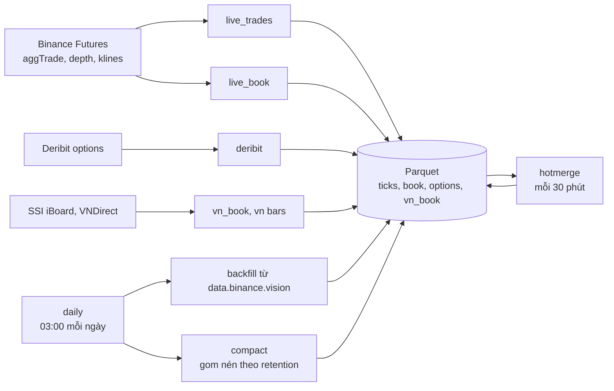

# Thu thập và lưu trữ dữ liệu

Phase 0 và 1. Trạng thái: xong. Phần vận hành còn việc mở.

Collector nhận dữ liệu từ Binance, Deribit và hai endpoint của VN100, rồi ghi xuống đĩa. Server và giao diện chỉ đọc từ đĩa. Nhờ vậy dữ liệu vẫn tích luỹ khi trình duyệt đóng.

## Sơ đồ



Sơ đồ tương tác của toàn hệ thống: [`plan.html`](plan.html), tab "Thu thập và lưu trữ".

## Quyết định

| Điều | Kế hoạch ghi | Thực tế | Lý do |
|---|---|---|---|
| Định dạng cấu hình | YAML | TOML (`tomllib`) | PyYAML chưa có bản dựng sẵn cho Python 3.15 |
| `uvicorn[standard]` | có | `uvicorn` thường | `[standard]` kéo theo PyYAML, mất tự reload |
| Schema `ticks` | `ts, p, q, m` | thêm `id` (aggregate trade id) | Cần khoá để loại trùng giữa backfill và collector, và để phát hiện khoảng hở |
| WebSocket aggTrade | `wss://fstream.binance.com/ws/...` | `/market/ws/<symbol>@aggTrade` | Binance chia đường dẫn và gỡ URL cũ ngày 2026-04-23. URL cũ im lặng với aggTrade |
| WebSocket depth | như trên | `/public/ws/<symbol>@depth@100ms` | Như trên |
| Cửa sổ sổ lệnh | ±1%, bucket 5 USD | ±0,15% (BTC), ±0,30% (vàng), bucket 1 USD hoặc 0,1 | Snapshot REST chỉ phủ khoảng ±0,2% |
| `node_modules` của web | junction trực tiếp | cài ở `C:\tv-data\web-deps`, nối junction sau | `npm install` trong `web\` xoá junction và cài vào OneDrive. Luôn dùng `scripts\web-deps.ps1` |
| File `.ps1` | có tiếng Việt | ASCII thuần | Windows PowerShell 5.1 đọc UTF-8 không BOM theo ANSI |

Dữ liệu nằm ngoài OneDrive, trong `DATA_DIR` (ví dụ `C:\tv-data`). Code từ chối đường dẫn trong OneDrive, vì OneDrive đồng bộ hàng nghìn file và khoá file khi collector ghi. Một bài học liên quan: file cấu hình trong OneDrive cũng có thể bị khoá tạm thời. Luồng lấp khoảng hở từng chết vì `PermissionError` khi đọc `config/symbols.toml` trong vòng lặp nóng. Nay `to_int_price` nhớ đệm theo mtime.

## Lưu trữ

Parquet zstd mức 9, đặt tên `kind/symbol/date=YYYY-MM-DD.parquet`, đọc bằng DuckDB. Schema gọn: `ts` int64 mili giây, `p` int32 theo tick size, `q` float32, `m` bool. SQLite (`app.sqlite`) giữ watchlist, hình vẽ và cảnh báo.

Dung lượng đo từ một ngày dữ liệu Binance (10/11/2026). Ngày biến động mạnh có thể gấp 2 đến 3 lần.

| Một ngày | BTCUSDT | XAUUSDT |
|---|---|---|
| Số lệnh khớp (aggTrades) | 1.521.662 | 602.627 |
| CSV gốc | 101,1 MB | 38,1 MB |
| Parquet zstd, đủ cột | 6,65 MB | 2,85 MB |
| Footprint gom 1 phút | 0,34 MB | 0,90 MB |
| Sổ lệnh tự ghi, ngoại suy từ 1 giờ yên tĩnh | khoảng 13 MB | khoảng 7 MB, chưa gộp |

| Cách lưu (BTC và XAUUSDT) | 1 năm | 5 năm |
|---|---|---|
| Giữ CSV gốc | khoảng 51 GB | khoảng 254 GB |
| Parquet đủ cột, mọi tick | khoảng 3,5 GB | khoảng 17 GB |
| Parquet, tick 30 ngày, sau đó footprint 1 phút | khoảng 0,7 GB | khoảng 2,5 GB |

### Dung lượng hiện tại

Đo ngày 2026-11-15 trên `C:\tv-data`: 502 MB, trong đó dữ liệu khoảng 320 MB. Phần còn lại là `.venv` (102 MB) và `web-deps` (84 MB).

| Thư mục | Dung lượng | Số file | Phạm vi |
|---|---|---|---|
| `ticks` | 228 MB (BTC 167, XAU 66) | 194 | 32 ngày, từ 2026-10-15 |
| `bars` | 61 MB | 13.162 | BTC, XAU 32 ngày. 100 mã VN100 khoảng 0,6 MB mỗi mã, 270 ngày |
| `bookdepth` | 23 MB | 60 | 30 ngày, dữ liệu tải về từ Binance |
| `book` | 6 MB | 145 | Mới ghi từ 2026-11-14, nhiều file con chưa gộp |
| `metrics` | 1 MB | 33 | 30 ngày |
| `options` | 1 MB | 8 | Mới ghi từ 2026-11-14 |
| `logs` | 1 MB | 11 | |
| `vn_book` | 0 MB | 0 | Chưa có phiên giao dịch |
| `app.sqlite` | 0,08 MB | 1 | |

### Ước tính khi lấy dữ liệu theo năm

Giả định collector chạy liên tục 24/7 cho BTCUSDT và XAUUSDT, kèm VN100. Nguồn số: dung lượng một ngày yên tĩnh ở bảng trên (tick 9,5 MB, sổ lệnh khoảng 20 MB, `bookdepth` 0,78 MB, nến 1 phút khoảng 35 KB mỗi symbol, nến VN100 khoảng 80 MB một năm). Ngày biến động mạnh làm tick và sổ lệnh gấp 2 đến 3 lần. Chưa có số đo cho `vn_book` và `options`, nên hai mục này không nằm trong tổng.

| Một năm | Dung lượng yên tĩnh | Biến động mạnh |
|---|---|---|
| Tick, giữ mọi tick | khoảng 3,5 GB | 7 đến 10 GB |
| Sổ lệnh 5 giây, giữ mọi snapshot | khoảng 7,3 GB | 15 đến 22 GB |
| `bookdepth` Binance | khoảng 0,29 GB | như cũ |
| Nến 1 phút (BTC, XAU, VN100) và `metrics` | khoảng 0,12 GB | như cũ |
| **Tổng, không gom nén** | **khoảng 11 GB** | **22 đến 33 GB** |
| **Tổng, theo chính sách giữ dữ liệu** | **khoảng 1,6 GB** | **khoảng 2,8 GB** |

Theo chính sách giữ dữ liệu, năm đầu gồm: footprint 1 phút 0,45 GB, cửa sổ tick 30 ngày 0,29 GB, sổ lệnh 0,44 GB (7 ngày ở 5 giây cộng 180 ngày ở 1 phút), `bookdepth` 0,29 GB, nến và `metrics` 0,12 GB. Chỉ footprint, `bookdepth` và nến tăng thêm mỗi năm, còn tick và sổ lệnh có trần. Sau 5 năm tổng khoảng 5 GB, hoặc khoảng 3,6 GB nếu xoá `bookdepth` (tải lại miễn phí được). Cả hai đều dưới trần `MAX_DATA_GB` mặc định 20.

Ngày 2026-11-15 `book` mới có 6 MB sau hơn một ngày ghi có gián đoạn, nên chưa dùng để ước tính. Số 20 MB mỗi ngày lấy từ phép đo 1 giờ.

### Chính sách giữ dữ liệu

File `config/retention.toml`. Tick 30 ngày, sau đó gom thành footprint 1 phút và xoá tick. Footprint 1 phút và nến 1 phút giữ mãi. Sổ lệnh tự ghi giữ 7 ngày ở mức 5 giây, sau đó gom thành 1 phút (giá trị lớn nhất mỗi bucket), giữ 180 ngày. Snapshot options giữ mỗi giờ trong 30 ngày, sau đó mỗi ngày một snapshot. Trần `MAX_DATA_GB` mặc định 20: vượt trần thì xoá tầng cũ nhất theo thứ tự sổ lệnh 1 phút, snapshot options, tick.

Gom nén chỉ đụng các ngày đã qua và kiểm tra tổng mua, bán từng phút trước khi xoá bản gốc. Trên dữ liệu thật 3 ngày, footprint chiếm 5,8% (BTC) và 6,2% (XAU) dung lượng tick. Đích là dưới 10%. Sau khi gom, footprint dưới 1 phút chỉ dựng lại được bằng cách tải lại file ngày từ Binance.

### Gộp nóng trong ngày

Mỗi collector ghi một file con mỗi 60 giây, nên cuối ngày mỗi symbol có hàng trăm file. Một lần tải biểu đồ từng mất khoảng 15 giây với hơn 1000 file con. `collector.hotmerge` gộp file con của ngày hôm nay mỗi 30 phút khi có từ 40 file. Việc gộp chỉ đụng các file có mặt lúc bắt đầu, nên an toàn khi collector đang chạy. Thử trên dữ liệu thật: 1072 file còn 31.

## Số đo

Nến dựng từ tick so với kline (3 ngày, 4320 nến 1 phút mỗi symbol):

| | BTCUSDT | XAUUSDT |
|---|---|---|
| Sai lệch tổng volume | 9,5e-9 | 1,2e-9 |
| Sai lệch tổng mua chủ động | 1,8e-10 | 7,8e-11 |
| Lệch lớn nhất một nến 1 phút | 27% | 350% (nến gần như không có volume) |
| Lệch lớn nhất một giờ | 0,67% | 1,3e-8 |

Tổng khớp gần tuyệt đối. Lệch từng nến đến theo cặp bù trừ: Binance gộp lệnh cùng giá trong 100 ms thành một aggTrade với thời điểm của lệnh đầu, còn kline xếp từng lệnh theo thời điểm riêng. Vì vậy nến 1 phút chuẩn lấy từ kline (kho `bars`), còn nến dựng từ tick dùng cho các khung khác. Tín hiệu dựa vào giá mở hoặc đóng của nến sát ranh giới có thể lệch nhẹ so với TradingView.

Snapshot REST 1000 mức phủ -0,207% đến +0,199% (BTC) và -0,364% đến +0,352% (vàng). Collector lấy snapshot mới mỗi 60 giây và đổi sang sổ mới khi đồng bộ xong. Mép ngoài vẫn có thể thiếu nếu giá đi hơn khoảng 0,05% trong 60 giây. Chưa có dấu "không đầy đủ" cho các dòng này.

## Nghiệm thu

- Sau 10 phút chạy, số dòng bảng tick tăng đều. Đã qua.
- Tổng `buy_vol + sell_vol` của nến 1 phút khớp kline, sai lệch dưới 0,1%. Đã qua (số trên).
- Chạy lại `backfill` không tải lại ngày đã có, kiểm checksum. Đã qua.
- `scripts/run-collectors.ps1` dựng lại tiến trình khi nó thoát. `collector.daily` chạy 9 bước trong 3 giây và thoát mã 0 trong lúc collector vẫn chạy. Đã qua ngày 2026-11-14.

## Giới hạn

Backfill hàng tháng (`monthly/`) của kho Binance chưa làm. `collector.backfill` từ chối hơn 366 ngày nếu thiếu `--yes`. Khoảng hở lớn khi collector khởi động lâu sau lần ghi cuối được lấp bằng REST ở luồng riêng, khoảng 15 phút cho 900 nghìn id. Khoảng hở trên 5 triệu id bị bỏ qua, ghi `skipped`, và phải dùng `collector.backfill`.

### Bộ nhớ của server

Ngày 2026-11-15 server uvicorn chạy nhiều giờ giữ 27,9 GB bộ nhớ cam kết (private bytes) trong khi RAM thật chỉ 2,5 GB. Commit của Windows lên 52,1 trên 52,6 GB (99%), nên các chương trình khác có thể bị lỗi cấp phát. Tắt tiến trình đó thì commit về 24 GB.

Nguyên nhân chưa xác định. Thử trên server mới với các yêu cầu nặng (nến mọi khung, footprint, heatmap, bong bóng, profile, GEX, hai script Pine dài, 40 lần nối WebSocket, mỗi vòng lặp 3 lần), bộ nhớ cam kết dao động 83 đến 376 MB và không tăng dần. Số đối tượng Python giữ nguyên sau 10 lần chạy Pine, nên không phải rò rỉ trong engine Pine. Phần còn lại cần theo dõi khi chạy dài. Vì vậy đã thêm biện pháp giới hạn thiệt hại thay vì sửa một nguyên nhân cụ thể:

- **Một instance DuckDB dùng chung** cho mọi truy vấn đọc (`store.query_conn()`), trần 1 GB (`DUCKDB_MEMORY_LIMIT`), 4 luồng (`DUCKDB_THREADS`), tràn ra `DATA_DIR\tmp`. Trước đó mỗi yêu cầu tạo một instance mới với trần mặc định 80% RAM. Cùng bộ thử, đỉnh còn 221 MB thay vì 376 MB.
- **Bộ giám sát trong server** (`server/memguard.py`): mỗi 30 giây đo bộ nhớ cam kết, ghi cảnh báo khi tăng từ 200 MB trở lên hoặc vượt 75% trần, kèm 5 đường dẫn được gọi nhiều nhất. Vượt `SERVER_MEM_LIMIT_MB` (mặc định 3072) thì server thoát với mã 75.
- **`dev.ps1` tự khởi động lại server** khi nó thoát, dừng nếu thoát hơn 5 lần trong 2 phút.
- `/health` trả thêm `private_mb`, `threads` và `limit_mb` để theo dõi.

Nếu server lại phình, dòng cảnh báo của `server.mem` trong cửa sổ `dev.ps1` cho biết đường dẫn nào được gọi ngay trước đó.

### Lệnh thu thập

Đặt `$py = 'C:\tv-data\.venv\Scripts\python.exe'` (hoặc đường dẫn venv của bạn), chạy từ thư mục dự án.

| Việc | Lệnh |
|---|---|
| Nến 1 phút 30 ngày gần nhất | `& $py -m collector.klines --symbol BTCUSDT --days 30` |
| Lịch sử tick (kiểm checksum) | `& $py -m collector.backfill --symbol BTCUSDT --dataset aggTrades --days 30` |
| Lịch sử độ sâu thô, open interest | `--dataset bookDepth` hoặc `--dataset metrics` |
| Kiểm tra nến dựng từ tick so với kline | `& $py -m collector.verify --symbol BTCUSDT --days 3` |
| Tick trực tiếp | `& $py -m collector.live_trades --symbols BTCUSDT,XAUUSDT` |
| Sổ lệnh trực tiếp (heatmap) | `& $py -m collector.live_book --symbols BTCUSDT,XAUUSDT` |
| Gom nén (thử trước) | `& $py -m collector.compact --dry-run` |
| Việc hằng đêm: nến, sửa khoảng thiếu, gom nén (thêm `--vn` để cập nhật nến VN100) | `& $py -m collector.daily` |
| Snapshot quyền chọn Deribit, mỗi 15 phút (GEX) | `& $py -m collector.deribit` |
| Cảnh báo nền (giá, cắt mức, `alertcondition` của Pine; gửi toast Windows và Telegram) | `& $py -m collector.alerts` |
| Gộp file con của ngày hôm nay mỗi 30 phút (truy vấn nhanh lại) | `& $py -m collector.hotmerge` (hoặc một lần: `-m collector.compact --hot`) |
| Danh sách VN100 từ SSI | `& $py -m collector.vn refresh-vn100` |
| Nến 1 phút VN100 (nạp lần đầu mất khoảng 1,5 giờ cho 100 mã) | `& $py -m collector.vn bars` |
| Sổ lệnh VN100, tự chỉ ghi trong giờ giao dịch HOSE | `& $py -m collector.vn_book` |

Collector trực tiếp chỉ chạy khi tiến trình còn sống. Đóng cửa sổ, tắt máy hoặc kết thúc phiên làm việc là chúng dừng, và dữ liệu sổ lệnh trong quá khứ không lấy lại được miễn phí. `.\scripts\run-collectors.ps1` khởi động mọi tiến trình nền, tự chạy lại nếu một cái thoát, ghi log vào `DATA_DIR\logs`, và chạy nền `collector.daily --vn` để crawl bù mỗi lần khởi động (tắt bằng `-SkipCatchup`). Cảnh báo chỉ bắn khi tiến trình `collector.alerts` còn sống, kể cả khi đã đóng trình duyệt.

Hai việc cần lên lịch (chạy một lần, đổi đường dẫn cho đúng):

```powershell
$root = 'C:\duong\dan\toi\TradingView'
schtasks /Create /TN tv-collectors /SC ONLOGON /TR "powershell -NoProfile -ExecutionPolicy Bypass -File $root\scripts\run-collectors.ps1"
schtasks /Create /TN tv-daily /SC DAILY /ST 03:00 /TR "cmd /c cd /d $root && C:\tv-data\.venv\Scripts\python.exe -m collector.daily --vn"
```

`collector.daily` là việc không thể thiếu, không chỉ là dọn dẹp. Với mỗi symbol nó chạy: (1) đồng bộ nến 1 phút (không có bước này `bars` đứng yên), (2) tải lại 3 ngày gần nhất từ kho Binance để sửa mọi khoảng thiếu của collector trực tiếp (máy tắt, khoảng hở bị bỏ qua), (3) gom nén. 03:00 giờ Việt Nam là 20:00 UTC, lúc đó file của ngày UTC hôm kia đã được Binance công bố. Mỗi bước bọc riêng, mã thoát khác 0 nếu có bước lỗi.

Gom nén chỉ đụng các ngày đã qua. Tick quá 30 ngày được gom thành footprint 1 phút (chỉ bằng khoảng 6% dung lượng) sau khi kiểm tra tổng mua và bán từng phút. Chính sách nằm trong `config/retention.toml`.

### Khoảng trống khi máy hoặc collector dừng

Ngày 2026-11-15 biểu đồ BTCUSDT thiếu khoảng 8 giờ (00:00 đến 08:00 giờ VN). Collector chạy trong phiên làm việc nên dừng cùng phiên. Có hai loại dữ liệu bị ảnh hưởng, và chúng lành khác nhau:

| Dữ liệu | Khi collector dừng | Cách lấp |
|---|---|---|
| Nến 1 phút (`bars`) | Không có nến mới. Chỉ `collector.klines` hoặc `collector.daily` ghi nến | Mỗi lần khởi động: `dev.ps1` đồng bộ nến 3 ngày trước khi mở server (vài giây), `run-collectors.ps1` chạy nền `collector.daily --vn` |
| Tick (`ticks`) | Mất tick cho đến lần chạy kế | Khi khởi động, `live_trades` tự lấp khoảng hở bằng REST, khoảng 40 nghìn id mỗi phút (1,67 triệu id mất khoảng 40 phút) |
| Sổ lệnh (`book`) | Mất vĩnh viễn, không có nguồn miễn phí để lấy lại | Không lấp được. Heatmap trống trong khoảng đó |

Việc chạy nền lúc khởi động (`collector.daily --vn`) gồm: nến 1 phút, tải lại 3 ngày từ kho Binance, nến VN100, gom nén. Kho Binance công bố file của ngày UTC hôm qua sau vài giờ, nên khoảng hở tick của hôm nay do `live_trades` lấp bằng REST, và file ngày chuẩn được thử lại ở lần khởi động hoặc 03:00 kế tiếp. Tắt bằng `-SkipCatchup`. Log nằm ở `DATA_DIR\logs\catchup-*.log`.

Biểu đồ ghép nến đã lưu với phần đuôi dựng từ tick, nên khoảng hở tick cũng làm thủng nến cho tới khi lấp xong. Cách giữ dữ liệu đủ trong ngày: chạy `run-collectors.ps1` bằng Task Scheduler để nó khởi động cùng Windows và không phụ thuộc phiên làm việc (xem việc còn mở bên dưới), và để `collector.daily` chạy lúc 03:00 để sửa các khoảng hở còn sót.

Mỗi collector hiện hai PID trong danh sách tiến trình vì venv Python 3.15 có một bộ khởi chạy và một tiến trình con. Đó là bình thường.

## Việc còn mở

- [ ] Chạy collector bằng Task Scheduler thay vì phiên làm việc: `scripts/run-collectors.ps1` và `python -m collector.daily --vn`. Mỗi ngày bỏ lỡ là mất tick, sổ lệnh và snapshot options vĩnh viễn. Lệnh `schtasks` có trong README gốc, mục Thu thập dữ liệu.
- [x] Cảnh báo khi collector im lặng hơn 5 phút (2026-11-15). Xem [09-alerts-drawing-backtest.md](09-alerts-drawing-backtest.md).
- [ ] Sao lưu `C:\tv-data` (ngoài OneDrive nên chưa có bản sao): `robocopy` hằng tuần sang ổ khác, loại `logs` và file `.tmp`.
- [ ] Bạn tự xoá thư mục thừa `C:\tv-data-bench`.
- [ ] Đo lại dung lượng sổ lệnh lúc biến động mạnh. Mới đo một giờ yên tĩnh.
- [ ] Phát hiện khi endpoint không chính thức đổi định dạng (SSI, VNDirect, Binance WS) và thông báo thay vì im lặng.
- [ ] Theo dõi cập nhật Binance. URL WS cũ đã bị khai tử 2026-04-23.
- [ ] Backfill hàng tháng cho lịch sử nhiều năm.

## Nguồn dữ liệu và chi phí

| Dữ liệu | Nguồn | Chi phí |
|---|---|---|
| BTC: nến, lệnh khớp, sổ lệnh | Binance Futures, API công khai | Miễn phí |
| BTC: GEX | Deribit, open interest trễ 8 giờ | Miễn phí |
| Vàng: orderflow, heatmap | Binance XAUUSDT, từ 11/12/2025 | Miễn phí |
| Vàng: volume COMEX, options | Databento (GC1!) | Trả phí, chưa làm |
| VN100: danh sách, bảng giá 3 mức | SSI iBoard, endpoint không chính thức | Miễn phí |
| VN100: nến 1 phút, khoảng 270 ngày | VNDirect dchart, endpoint không chính thức | Miễn phí |
| Sổ lệnh từng mức giá trước ngày bắt đầu ghi | Tardis.dev | Trả phí, khoảng $700/tháng, chưa xác nhận gói |
| Lịch sử options Deribit | Không có | Chỉ từ lúc collector ghi |
| XAUUSD spot có volume | Không tồn tại | Spot là thị trường OTC |

Mỗi nguồn có điều khoản riêng. Dùng cá nhân. Đọc điều khoản trước khi chia sẻ dữ liệu.
