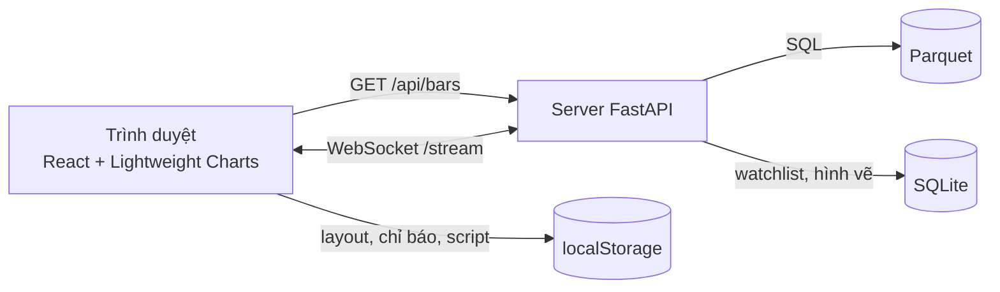

# Biểu đồ và giao diện

Phase 2 và nhóm UX. Trạng thái: xong. Còn việc nhỏ ở layout, editor và kiểm thử giao diện.

Stack cố định: Vite, React, TypeScript, Lightweight Charts v5 (Apache-2.0, bắt buộc ghi attribution). Lightweight Charts chỉ có nến cơ bản, nên heatmap, footprint và hình vẽ là primitive canvas 2D tự viết. Dự án không dùng tên, logo hay giao diện của TradingView.

## Sơ đồ

## Tính năng đã làm

Nến, pane volume (màu theo hướng), crosshair, múi giờ chọn được, khung `1s` đến `1M`, nến chạy trực tiếp qua WebSocket, cuộn về quá khứ tải thêm dữ liệu. Danh sách theo dõi kéo thả để sắp xếp, lưu trong SQLite. Giao diện tối là mặc định theo hệ thống, có nút đổi sang sáng.

Thanh trên cùng có một hàng: symbol và trạng thái trực tiếp, khung thời gian, nút **Chỉ báo**, bố cục 1/2/4 ô, múi giờ, Replay, Cảnh báo, Pine, đổi sáng/tối. Mọi tính năng orderflow nằm trong bảng **Chỉ báo**: bốn mẫu dựng sẵn (Sạch, Footprint, Bookmap, Profile), công tắc có mô tả một dòng, thanh trượt cho ngưỡng. Tính năng không dùng được cho symbol hiện tại (ví dụ tick của cổ phiếu VN) bị làm mờ kèm giải thích. Trên điện thoại (390 px) vùng biểu đồ chiếm hơn một nửa màn hình, thanh vẽ nằm ngang và ô múi giờ ẩn (giá trị đã lưu vẫn dùng).

Phím tắt: `/` hoặc `Ctrl+K` tìm symbol, `[` và `]` đổi khung, `T` đổi sáng/tối, `I` mở bảng chỉ báo, `?` xem danh sách phím, `Ctrl+Enter` chạy Pine, `Esc` đóng bảng.

### Khung tuần và tháng

`1w` bắt đầu thứ Hai 00:00 UTC, `1M` bắt đầu ngày 1 00:00 UTC, gộp từ nến 1 phút trong DuckDB. Ranh giới theo lịch, không chia đều từ epoch, vì chia đều thì tuần bắt đầu thứ Năm. Nến đang chạy cập nhật theo lệnh khớp với cùng ranh giới. Không hỗ trợ `2M`, `2w`, và footprint không có hai khung này. Ngày tính theo UTC nên tuần của cổ phiếu VN (phiên 02:00 đến 08:00 UTC) vẫn đúng.

### Layout nhiều ô

Ô 1, 2 hoặc 4. Mỗi ô chọn symbol và khung riêng, lưu trong localStorage. Cuộn, zoom và crosshair đồng bộ theo mốc thời gian. Chỉ thay đổi do người dùng thao tác trực tiếp mới lan sang ô khác, để việc nạp dữ liệu của một ô không kéo các ô còn lại. Ô phụ chưa có Pine và replay. Mỗi ô mở một kết nối trực tiếp riêng, và server dùng chung nguồn Binance.

## Nghiệm thu

- Nến BTC cập nhật theo thời gian thực. Đã qua.
- Cuộn về quá khứ tải thêm dữ liệu mà không giật. Đã qua.
- Trang trống hiện "server OK" từ `/health` ở Phase 0. Đã qua.

## Việc còn mở

- [ ] Lưu layout nhiều ô vào SQLite và đặt tên được. Hiện nằm trong localStorage.
- [ ] Kiểm thử giao diện tự động bằng Playwright hoặc tương đương. Hiện kiểm thử giao diện làm tay qua trình duyệt.
- [ ] Sắp xếp lớp vẽ của nhiều chỉ báo bằng kéo thả. Xem [08-pine-engine.md](08-pine-engine.md).
- [ ] Sửa điểm neo của hình vẽ. Hiện chỉ xoá rồi vẽ lại. Xem [09-alerts-drawing-backtest.md](09-alerts-drawing-backtest.md).
