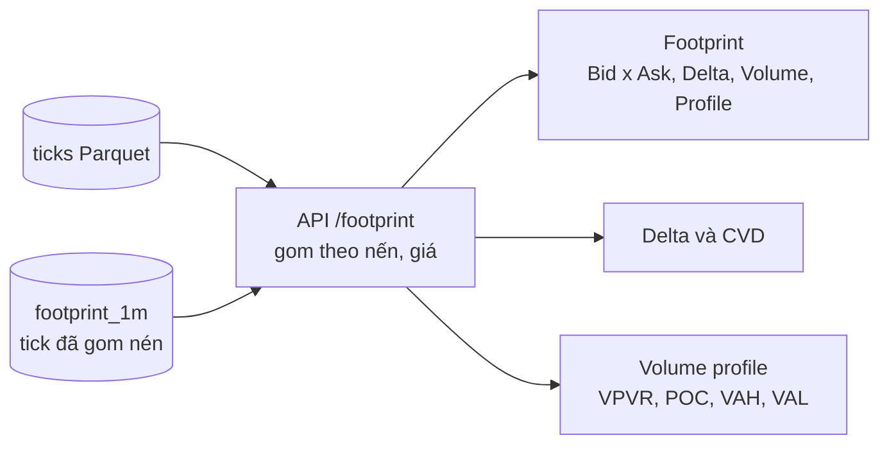
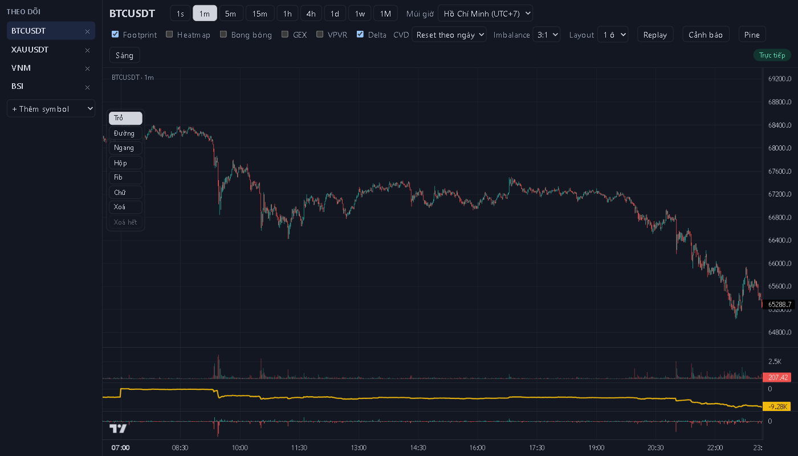
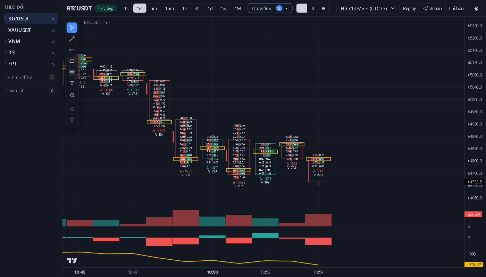

# Orderflow

Phase 3. Trạng thái: xong, trừ volume profile theo phiên. Còn các kiểu hiển thị nâng cao.

Orderflow cho thấy bên nào chủ động mua hoặc bán ở từng mức giá trong mỗi nến. Dữ liệu vào là `aggTrade` của Binance, có cờ `isBuyerMaker`: `true` nghĩa là bên bán chủ động. Thiết kế hiển thị bám theo tài liệu công khai của DeepCharts (Deep Print, DeepDom, Deep Trades). Mã màu, tỉ lệ và công thức là của dự án, không sao chép mã hay tài sản của họ.

## Sơ đồ

## Tính năng đã làm

Footprint có bốn kiểu: Bid x Ask, Delta, Volume, Profile. Ô `bán x mua` theo từng mức giá, màu theo imbalance chéo (ngưỡng 2:1 đến 5:1, mặc định 3:1), viền vàng là POC, vạch đậm ở mép nến là stacked imbalance từ 3 mức liên tiếp. Dòng `Δ` và `V` dưới mỗi nến cho delta và volume của cả nến. Chữ co theo chiều cao ô. Kiểu Profile vẽ thanh ngang hai phía từ tâm nến: bán bên trái, mua bên phải. Pane delta và CVD reset theo phiên. VPVR có POC, VAH, VAL.

Footprint không có ở khung `1w` và `1M`. Chữ số trong ô và ngưỡng imbalance chỉnh trong bảng Chỉ báo.

## Giới hạn dữ liệu

Delta và CVD của cổ phiếu VN bằng 0, vì VN chỉ có nến và snapshot sổ lệnh, không có tick. Xem [07-vn100.md](07-vn100.md). Lệnh lớn của DeepCharts phân loại bằng dữ liệu MBO. Binance chỉ có aggTrade, nên ký hiệu lệnh đơn lẻ và lệnh cộng dồn ở đây không tương đương hoàn toàn.

## Nghiệm thu

- Tổng delta trong footprint bằng delta của pane delta với mọi nến kiểm tra. Có test.
- Footprint dựng từ tick và từ `footprint_1m` (sau gom nén) cho cùng tổng mua và bán mỗi phút.

## Việc còn mở

- [ ] Volume profile theo phiên. Hiện chỉ có VPVR trên đoạn đang xem.
- [ ] Footprint nhiều cột cạnh nhau (Multi Column), `Imbalance Horizontal`.
- [ ] Phân biệt thanh khoản mới và thanh khoản tồn tại lâu.
- [ ] Ký hiệu hình vuông và hình thoi kiểu Deep Trades. Cần dữ liệu MBO để biết lệnh chờ hay lệnh chủ động. Binance không có, nên bị chặn.
- [ ] DOM ladder. Cần dữ liệu sổ lệnh tức thời trên giao diện: xem [04-heatmap.md](04-heatmap.md).
- [ ] Cảnh báo theo điều kiện orderflow (delta, CVD, imbalance): xem [09-alerts-drawing-backtest.md](09-alerts-drawing-backtest.md).
