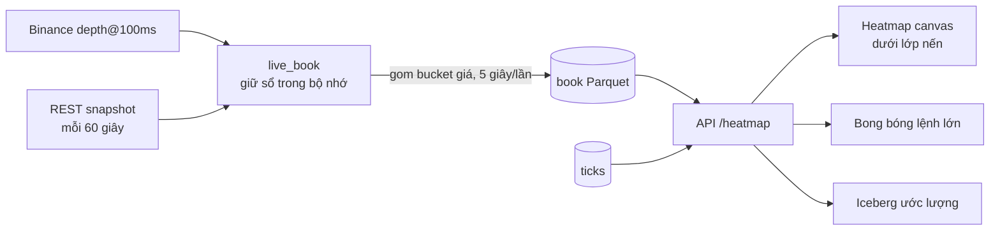
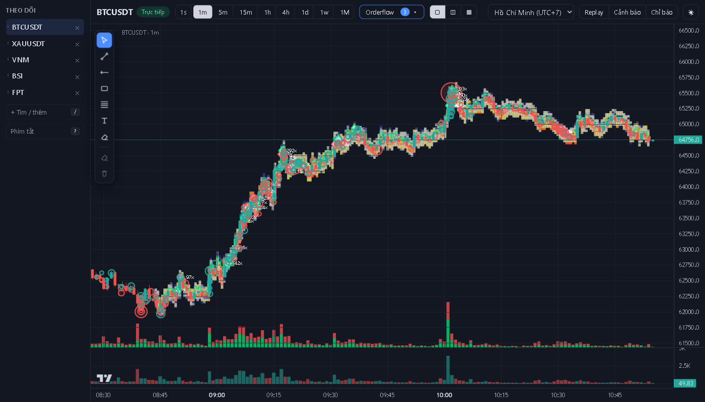
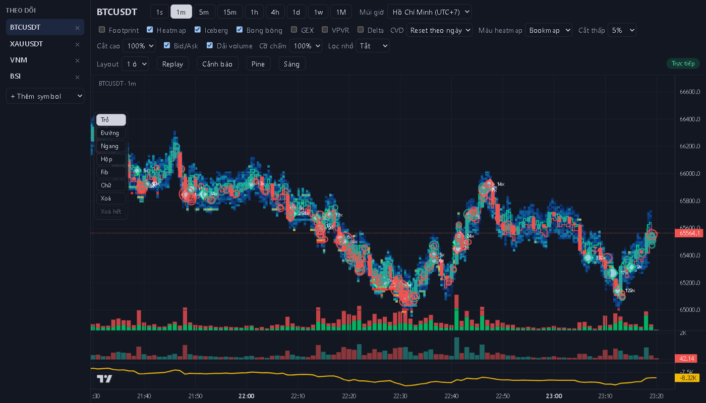
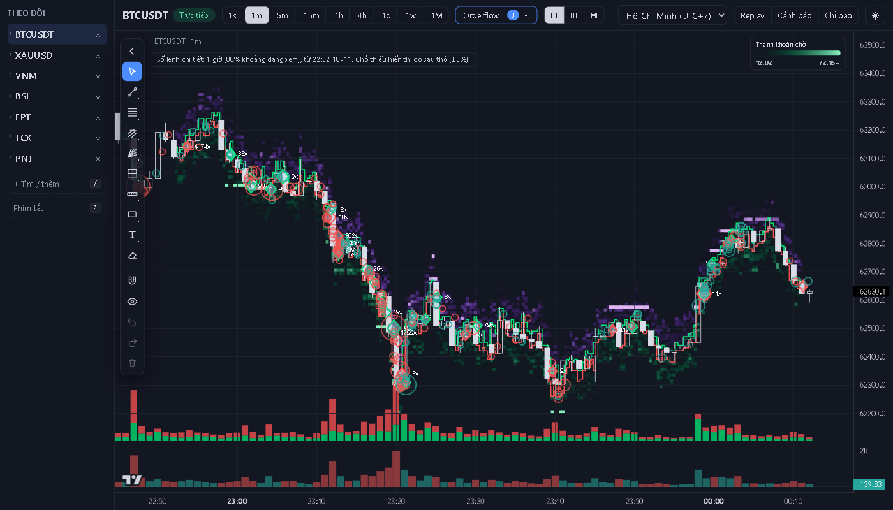

# Heatmap thanh khoản

Phase 4. Trạng thái: xong. Chưa đo thời gian vẽ so với đích 100 ms.

Heatmap cho thấy lệnh chờ trên sổ lệnh: trục ngang là thời gian, trục dọc là giá, màu càng nóng thì lệnh chờ càng lớn. Nó bổ sung cho [orderflow](03-orderflow.md): orderflow cho thấy lệnh đã khớp, heatmap cho thấy lệnh đang chờ. Heatmap không cho biết ý định, vì lệnh chờ có thể là lệnh giả (spoofing) hoặc lệnh ẩn (iceberg).

## Sơ đồ

## Thiết kế

Collector `live_book` giữ sổ lệnh trong bộ nhớ từ luồng diff và snapshot REST, kiểm `lastUpdateId` để sổ không lệch. Mỗi 5 giây nó gom theo bucket giá (1 USD với BTC, 0,1 với vàng) và ghi `(ts, price_bucket, bid_size, ask_size)`. Cửa sổ ±0,15% quanh giá với BTC, ±0,30% với vàng, theo vùng snapshot REST phủ được.

Lịch sử miễn phí của Binance (`bookDepth`) chỉ có 6 dải tích luỹ ±0,2% đến ±5%, cách 30 giây, từ 2023. Nó đủ cho bản đồ thô, không thay được sổ lệnh từng mức giá. Lịch sử từng mức giá chỉ có từ lúc collector bắt đầu ghi.

### Kiểu hiển thị

Hai kiểu màu, cả hai chuẩn hoá theo phân vị 99 của đoạn đang xem nên tự co giãn theo thị trường.

- **Bookmap** (mặc định): nền đen, xanh đậm, xanh dương, cyan, vàng, cam, đỏ. Có ngưỡng cắt thấp và cao, đường bid và ask tốt nhất dạng bậc thang, dải volume mua/bán dưới đáy vùng giá, chấm volume có cỡ và bộ lọc lệnh nhỏ.
- **Cường độ** theo DeepDom: đen, xanh dương, trắng, vàng, cam, đỏ. Có kiểu màu Mua/Bán: lệnh mua chờ xanh lá, lệnh bán chờ tím.

Bong bóng lệnh lớn theo Deep Trades: vòng đặc là cụm chỉ có một aggTrade, vòng rỗng là nhiều aggTrade cùng ô thời gian và giá. Xanh là mua chủ động, đỏ là bán chủ động.

Nguồn tham khảo cho Bookmap là kết quả tìm kiếm và blog bản 7, chưa đọc tài liệu gốc. Mô tả màu mặc định của Bookmap không thống nhất giữa các nguồn, nên thang màu là của dự án.

### Iceberg

Iceberg chỉ là ước lượng có độ tin cậy thấp. Ô (thời gian, giá) bị đánh dấu khi khối lượng khớp lớn hơn 5 lần thanh khoản hiển thị ở phía bị đánh. Sổ lệnh chỉ lấy mẫu mỗi 5 giây và gom theo bucket, còn khối lượng khớp cộng cả ô thời gian. Trên dữ liệu thật, hàng nghìn ô vượt ngưỡng chỉ vì dòng lệnh bình thường. Vì vậy API chỉ giữ 40 ô có khối lượng khớp lớn nhất. Bookmap suy luận tương tự nhưng dùng dữ liệu từng lệnh (MBO), mà Binance không có.

## Số đo

Dung lượng sổ lệnh sau 61 phút (19:00 đến 20:01, yên tĩnh): BTCUSDT 0,56 MB trong 59 file con, XAUUSDT 0,31 MB trong 58 file con, chưa gộp. Quy ra khoảng 13 MB một ngày cho BTC và 7 MB cho XAU. Ngân sách kế hoạch là 15 đến 25 MB. Số XAU cao hơn mẫu 14 phút (2,5 MB) vì chưa gộp, và sẽ giảm sau `merge_day`.

Collector đồng bộ lại 14 lần trong 14 phút mẫu đầu, không có cảnh báo `pu != u`.

## Nghiệm thu

- Heatmap cuộn và zoom cùng trục với nến. Đã qua.
- Với 2 giờ dữ liệu, vẽ dưới 100 ms mỗi khung hình. **Chưa đo.**

## Việc còn mở

- [ ] Đo thời gian vẽ heatmap với 2 giờ dữ liệu, so với đích 100 ms.
- [ ] Đo lại dung lượng sổ lệnh lúc biến động mạnh: xem [01-collector-storage.md](01-collector-storage.md).
- [ ] DOM ladder. Cần dữ liệu sổ lệnh tức thời trên giao diện.
- [ ] Kiểu gom chấm "Smart" kiểu Bookmap.
- [ ] Cột volume và delta theo mức giá ở mép phải, gắn với heatmap. VPVR riêng đã có.
- [ ] Heatmap lịch sử trước ngày bắt đầu thu thập, qua Tardis (trả phí), để backtest bằng heatmap. Bị chặn: cần tiền.
- [ ] Heatmap thanh lý (Coinglass hoặc tự ước tính từ open interest). Chưa rõ gói nào có endpoint này.
