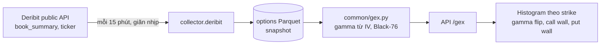
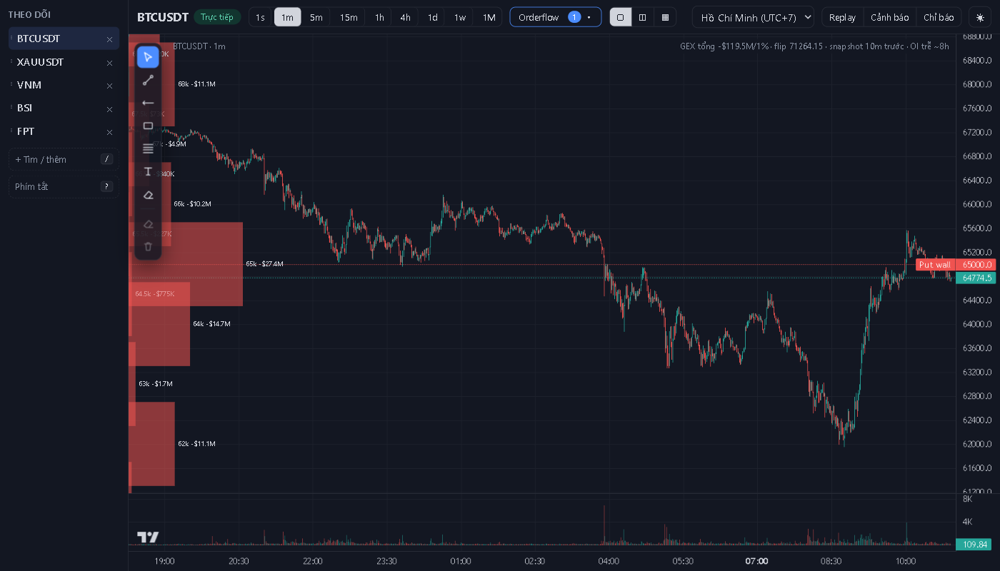

# GEX cho BTC

Phase 5. Trạng thái: xong.

GEX (gamma exposure) ước tính mức các nhà tạo lập thị trường phải mua hoặc bán để cân bằng rủi ro options. Kết quả hiện thành histogram theo strike và ba mức giá tham chiếu: gamma flip, call wall, put wall.

## Sơ đồ

## Công thức

Với mỗi strike: `gamma × OI × contract_size × spot² × 0,01`. Call tính dương, put tính âm. Gamma tính từ IV bằng Black-76 khi nguồn thiếu. Giả định nhà tạo lập long call và short put. Đây là mô hình, không phải vị thế thật.

## Giới hạn

Deribit xác nhận trong changelog rằng open interest công khai trễ 8 giờ, kể cả ở endpoint `ticker`. GEX vì vậy chỉ dùng theo ngày, và giao diện ghi nhãn tuổi dữ liệu cùng "OI trễ 8 giờ". Gọi API dồn dập sẽ bị giới hạn tốc độ (đã gặp lỗi khi gọi liên tiếp), nên collector giãn nhịp và thử lại. Deribit không có lịch sử open interest miễn phí: backtest GEX chỉ đúng từ lúc collector bắt đầu ghi snapshot. Cổ phiếu VN không có options niêm yết nên không có GEX.

Chính sách giữ: snapshot mỗi giờ trong 30 ngày, sau đó một snapshot mỗi ngày.

## Nghiệm thu

- Tổng GEX khớp tính tay trên 3 strike mẫu. Có test trong `tests/` (đối chiếu độc lập).

## Việc còn mở

- [ ] Cảnh báo theo GEX flip: xem [09-alerts-drawing-backtest.md](09-alerts-drawing-backtest.md).
- [ ] `request.external("gex_levels")` trong Pine đã có. Chưa có backtest dài hạn vì lịch sử ngắn.
- [ ] GEX vàng: xem [06-gold.md](06-gold.md).
