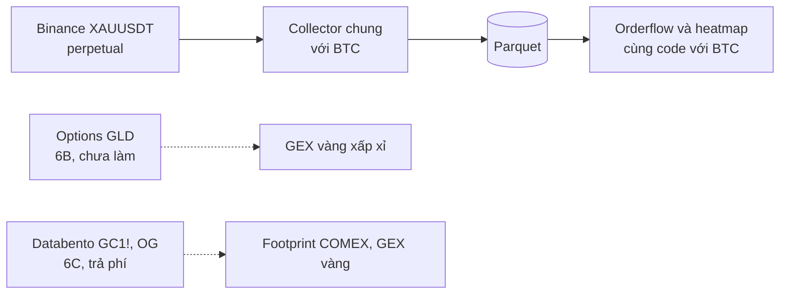

# Vàng

Phase 6. Trạng thái: 6A xong. 6B và 6C là tuỳ chọn, chưa làm.

XAUUSD spot không có volume tập trung vì là thị trường OTC. Nguồn volume thật cho vàng là hợp đồng GC của CME. Dự án dùng hợp đồng XAUUSDT perpetual của Binance làm bản miễn phí.

## Sơ đồ

Đường nét đứt là phần chưa làm hoặc chưa xác minh.

## 6A. XAUUSDT của Binance

Kiểm chứng ngày 2026-11-14:

- Hợp đồng loại `TRADIFI_PERPETUAL`, `underlyingType` COMMODITY, tick 0,01 USDT, bước khối lượng 0,001. Khối lượng tính theo ounce, 1 hợp đồng bằng 1 oz.
- `klines`, `aggTrades` và `depth` trả dữ liệu không cần key. Kho `data.binance.vision` có `aggTrades` và `bookDepth` từ 11/12/2025.
- `/fapi/v1/tradingSchedule` báo nhóm COMMODITY đóng cửa từ thứ Sáu 22:00 đến Chủ nhật 23:00 UTC. Hợp đồng perpetual vẫn khớp lệnh suốt thứ Bảy 14/11: collector ghi 12 triệu tick trong 24 giờ, mọi giờ đều có lệnh. Cuối tuần giá XAUUSDT không bám giá COMEX hay spot vì thị trường gốc nghỉ, nên đừng dùng nó để so với XAUUSD vào cuối tuần.
- Lúc đo, giá cuối 3878,84 và `indexPrice` 3881,10, tức perp thấp hơn chỉ số khoảng 0,06%. Chưa có nguồn miễn phí cho XAUUSD spot để đối chiếu độc lập.
- Khoảng 12 triệu tick một ngày, nhiều hơn BTC. Gom nén vẫn theo quy tắc 30 ngày.
- Giao diện ghi: "Volume và orderflow của hợp đồng Binance, không phải COMEX".

Binance liệt kê 237 hợp đồng loại này, nên sau này có thể thêm bạc và tài sản khác bằng cùng code.

## 6B. GEX vàng xấp xỉ từ GLD

Tuỳ chọn, miễn phí nhưng chưa chắc. Chuỗi options GLD (trễ khoảng 15 phút) có trên Cboe delayed quotes và Yahoo. GLD là ETF, không phải COMEX, nên mức giá quy đổi sang XAUUSD bằng tỉ lệ GLD trên spot. Điều khoản sử dụng của hai nguồn chưa đọc. Nếu điều khoản cấm tự động hoá, bỏ hạng mục này.

## 6C. GC1! và options vàng

Tuỳ chọn, trả phí. Chỉ bắt đầu khi bạn đồng ý trả tiền và `.env` có `DATABENTO_API_KEY`. Databento cho `trades` và `mbp-10` của GC từ `GLBX.MDP3` (lịch sử mbp-10 từ 2010, mbo từ 2017) và options OG. Trang giá ghi gói Standard $199/tháng, Plus $1.750, Unlimited $4.500, tặng $125 credit lịch sử trong 6 tháng. Trang có nhắc mốc 3/2025 nên có thể đã cũ, và giá theo GB không công bố. Từng có báo cáo strike OG bị chia 100, cần kiểm tra. Hỏi bạn trước khi tải dữ liệu tính theo GB.

## Nghiệm thu

- XAUUSDT hiện nến, footprint và heatmap. Đã qua.
- Chênh lệch với XAUUSD spot được ghi nhận. Đã ghi (mục 6A).
- 6C: GC1! hiện footprint thật. Chưa làm.

## Việc còn mở

- [ ] **Chặn: cần khoá và tiền.** GC1! và options vàng qua Databento. Đo giá thật trước khi mua.
- [ ] Đọc điều khoản nguồn của options GLD trước khi tự động hoá 6B. Bỏ nếu cấm.
- [ ] Đo lại dung lượng sổ lệnh XAU lúc biến động mạnh: xem [01-collector-storage.md](01-collector-storage.md).
