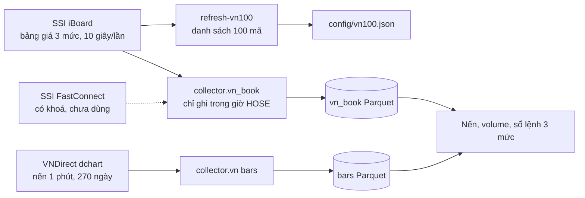

# Cổ phiếu VN100

Phase 7. Trạng thái: danh sách, nến 1 phút và bộ ghi sổ lệnh 3 mức đã xong. **Chưa đo phiên giao dịch thật.** Phiên đầu để đo là Thứ Hai 16/11/2026, từ 08:55 giờ VN.

Phạm vi là rổ VN100 (VN30 cộng 70 mã VNMidCap, đều niêm yết HOSE). Không thu thập mã ngoài rổ. Không có GEX, vì cổ phiếu niêm yết không có options.

## Sơ đồ

## Nguồn dữ liệu

Không có khoá SSI FastConnect, nên dự án dùng hai endpoint công khai không có tài liệu chính thức. Chúng có thể đổi định dạng hoặc bị chặn bất cứ lúc nào. Chỉ dùng cá nhân, gọi thưa. Điều khoản của hai bên chưa đọc.

**SSI iBoard** (`iboard-query.ssi.com.vn/stock/group/VN100`): trả đúng 100 mã, tất cả `hose`, 196 KB và 0,2 giây mỗi lần gọi. Có `best1..3Bid/Offer` kèm khối lượng, `nmTotalTradedQty`, `stockBUVol` (mua lên) và `stockSDVol` (bán xuống). BU cộng SD bằng đúng tổng khối lượng khớp. Đây là snapshot chứ không phải từng lệnh khớp, nên mọi số liệu orderflow VN là xấp xỉ theo nhịp lấy mẫu 10 giây.

**VNDirect dchart** (`dchart-api.vndirect.com.vn/dchart/history`): nến 1 phút có khoảng 270 ngày (từ 2025-10-31), khoảng 29 000 nến mỗi mã. Giá là nghìn đồng, 3 chữ số thập phân, đã điều chỉnh sự kiện doanh nghiệp, nên kho dùng tick 0,001. Lần nạp đầu ghi 131 file ngày mỗi mã, mỗi file khoảng 0,2 giây, nên cả VN100 mất khoảng 1,5 giờ.

SSI FastConnect (API chính thức) chỉ cấp cho khách có tài khoản SSI, hạn 1 năm, phí chưa rõ, và chưa biết giới hạn số mã streaming trên một key. vnstock (Guest 20 lượt/phút, Community 60 lượt/phút) có giấy phép phi thương mại. Trường `Side` của SSI là hướng của tick, không chắc là bên chủ động.

## Lịch sử quá khứ

Câu hỏi: có crawl được sổ lệnh VN100 theo thời gian trong quá khứ không? Kết luận ngày 2026-11-15: **không, với nguồn miễn phí đã thử.** Sổ lệnh VN100 chỉ có từ lúc `vn_book` bắt đầu ghi.

| Dữ liệu | Có trong quá khứ? | Kiểm tra |
|---|---|---|
| Nến 1 phút (OHLCV) | Có, khoảng 270 ngày | VNDirect dchart trả 200 và đủ nến. Đã dùng trong dự án |
| Sổ lệnh 3 mức giá theo thời gian | Không | iBoard của SSI chỉ trả ảnh chụp hiện tại, không có tham số thời gian. Không tìm thấy endpoint lịch sử |
| Từng lệnh khớp (tick) | Không dùng được | Endpoint intraday của TCBS (thư viện vnstock dùng) bị Cloudflare chặn khi gọi bằng script (HTTP 403, trang "Just a moment"). Không thử vượt chặn. Chưa kiểm endpoint này có lùi được qua các phiên cũ không |
| Mua lên và bán xuống (`bu`, `sd`) | Không | Chỉ có trong ảnh chụp hiện tại của iBoard |

**FireAnt** (thử ngày 2026-11-15, đọc đặc tả Swagger công khai `api.fireant.vn/swagger/docs/v1` rồi gọi thử): **có dữ liệu giá ngày VN rất sâu và đủ trường, nhưng không có sổ lệnh hay tick.**

- **Xác thực:** không có API key. Chỉ OAuth2 Implicit Grant cùng các endpoint đăng nhập (mật khẩu, Google, Facebook, Apple, nặc danh) và `refresh-token`. `POST /authentication/anonymous-login` không cần tài khoản, không cần thân yêu cầu, trả `accessToken` có hạn khoảng 9,5 năm (không có refresh token) và scope gồm `symbols-read`. Token này cũng mang các scope `orders-write`, `accounts-write`, `posts-write`: **không dùng các scope đó**, chỉ đọc dữ liệu giá. Chưa đọc điều khoản dùng; token nặc danh có thể bị thu hồi hoặc đổi chính sách bất cứ lúc nào.
- **`GET /symbols/{symbol}/historical-quotes?startDate=&endDate=&offset=&limit=`** trả 200 với token nặc danh. Độ sâu: dò theo `offset` cho thấy dữ liệu từ khoảng tháng 10/2006 (VNM), tức khoảng 5.500 phiên, nên phủ trọn giai đoạn từ 2010. Mỗi dòng một ngày gồm: giá mở, cao, thấp, đóng, giá trung bình, giá tham chiếu, `totalVolume`, `dealVolume`, `putthroughVolume`, `totalValue`, mua và bán của nước ngoài (khối lượng và giá trị), room ngoại còn lại, tự doanh ròng, và **`buyCount`, `buyQuantity`, `sellCount`, `sellQuantity`** (số lệnh và khối lượng đặt mua, đặt bán cả ngày, tổng hợp, không phải từng mức giá).
- **Khớp với dự án:** VNM ngày 2026-11-13 `totalVolume` 2.391.600, bằng đúng `nmTotalTradedQty` của SSI và nến ngày của dchart đã ghi ở mục Số đo volume. Vậy đây là nguồn volume ngày độc lập thứ ba, dùng được để kết luận nến 1 phút của dchart thiếu lệnh khớp.
- **Chưa kiểm:** các endpoint tài chính (`financial-indicators` trả 200, chưa xem nội dung), giới hạn tốc độ, việc có luồng thời gian thực hay không, và điều khoản sử dụng.
- **Không có:** sổ lệnh theo mức giá, tick, khớp lệnh trong phiên. `/symbols/{symbol}/transactions` là giao dịch của tổ chức (cổ đông lớn), không phải lệnh khớp thị trường.

Ý nghĩa: không lấp được khoảng trống sổ lệnh quá khứ, nhưng cho lịch sử ngày từ 2006 với dòng tiền ngoại, tự doanh và áp lực đặt mua, đặt bán cả ngày. Phù hợp làm lớp dữ liệu ngày cho backtest cổ phiếu VN và để đối chiếu volume.

Chưa kiểm, chỉ là hiểu biết chung: API chính thức SSI FastConnect có nến trong ngày và nến ngày theo khoảng ngày, nhưng sổ lệnh chỉ phát trực tiếp. Dữ liệu sổ lệnh lịch sử của HOSE do các nhà cung cấp trả phí bán, chưa xác minh giá và điều kiện.

Hệ quả: lịch sử sổ lệnh VN100 bắt đầu từ phiên đầu tiên `vn_book` chạy (Thứ Hai 16/11/2026), và mỗi phiên bỏ lỡ là mất vĩnh viễn, giống sổ lệnh BTC. Phần có thể làm cho quá khứ là volume profile theo phiên từ nến 1 phút (rải volume của nến lên khoảng giá cao thấp), chỉ là xấp xỉ, không phải sổ lệnh.

## Sổ lệnh

HOSE chỉ có 3 mức giá mua và bán. Mỗi dòng gồm `ts, symbol, bid1..3, ask1..3` kèm khối lượng. Bộ ghi `vn_book` chỉ chạy trong giờ giao dịch HOSE. Dung lượng chưa có số đo, vì thị trường đóng cửa thứ Bảy 14/11.

## Số đo volume

Tổng nến 1 phút so với nến ngày của dchart, 43 ngày gần nhất:

| Mã | Lệch trung vị | Lệch tối đa |
|---|---|---|
| VNM | 0,00% | 4,06% |
| FPT | 0,85% | 7,84% |
| VCB | 0,50% | 13,13% |

Nến ngày của dchart khớp chính xác `nmTotalTradedQty` của SSI (VNM 2026-11-13: 2 391 600 ở cả hai). Vậy nến 1 phút của dchart thiếu một phần lệnh khớp ở một số ngày. Nguyên nhân chưa rõ, dù nến ATO 09:15 và ATC 14:45 có mặt. Đích 0,5% chỉ đạt với nến ngày. Khi cần volume ngày chính xác, dùng nến ngày của dchart hoặc bộ đếm `tv` của sổ lệnh.

## Nghiệm thu

- `vn100.json` có đúng 100 mã, tất cả trên HOSE. Đã qua.
- VNM, FPT, VCB hiển thị volume khớp trang nguồn. Đạt với nến ngày, chưa đạt với tổng nến phút.
- Sau một phiên, mỗi mã có sổ lệnh với số dòng lớn hơn 0. **Chưa làm, cần phiên giao dịch.**
- Tổng volume khớp volume nến ngày, sai lệch dưới 0,5%. Đạt với nến ngày.

## Việc còn mở

- [ ] **Chặn: cần phiên giao dịch.** Chạy `vn_book` suốt một phiên (Thứ Hai 16/11, từ 08:55 giờ VN), rồi đo số dòng và dung lượng mỗi mã, ghi vào [engineering-notes.md](engineering-notes.md).
- [ ] Nghiệm thu "mỗi mã có sổ lệnh với số dòng lớn hơn 0 sau một phiên".
- [ ] Tìm nguyên nhân volume nến 1 phút lệch volume ngày. So với bộ đếm `tv` của sổ lệnh. Nếu không giải thích được, dùng nến ngày của dchart làm chuẩn cho khung `1d`.
- [ ] Delta xấp xỉ cho VN từ hiệu của `bu` và `sd` giữa hai lần lấy mẫu. Hiện delta và CVD của VN bằng 0.
- [ ] Volume profile theo phiên và bản đồ nhiệt 3 mức giá cho VN. Cần dữ liệu sổ lệnh thật trước.
- [ ] Quyết định chuyển sang SSI FastConnect (có khoá, ổn định hơn) hay giữ hai endpoint không chính thức.
- [ ] Phát hiện khi SSI hoặc VNDirect đổi định dạng: xem [01-collector-storage.md](01-collector-storage.md).
