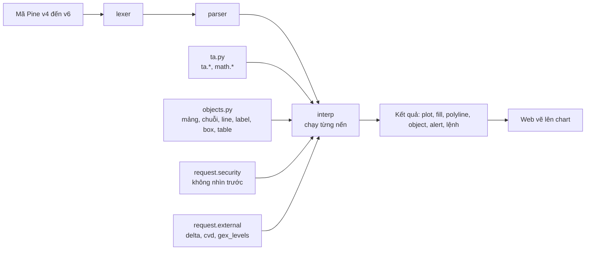
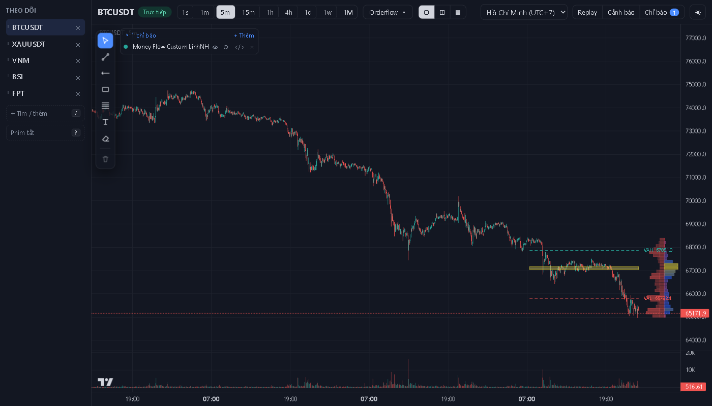
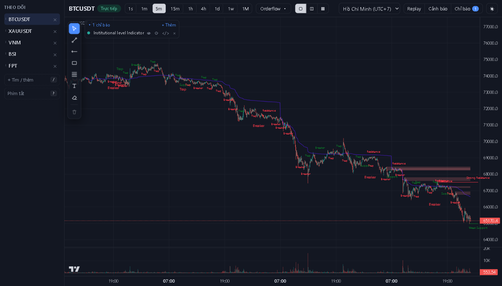
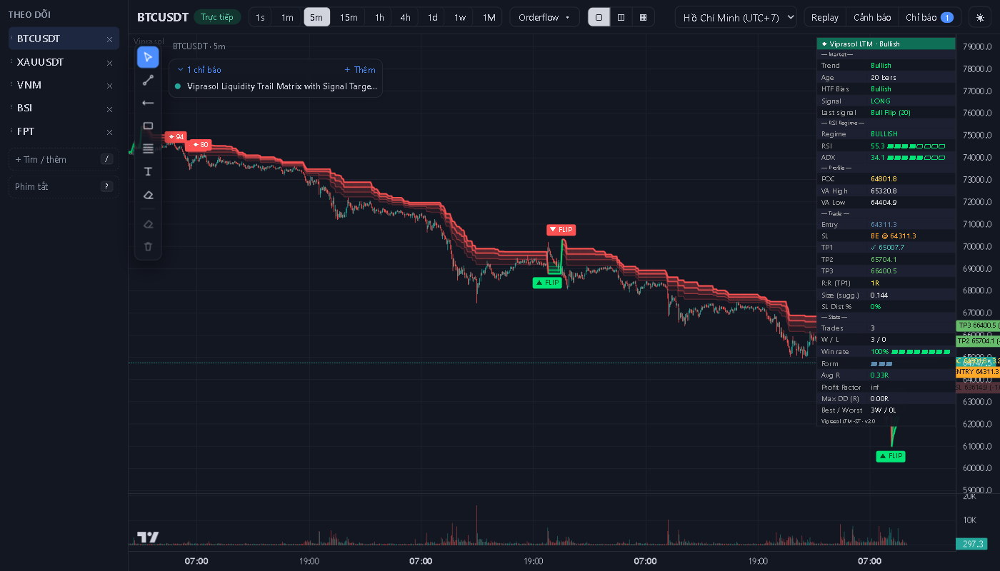
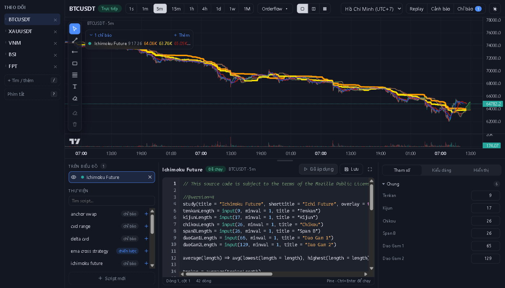

# Engine Pine Script

Phase 8 và nhóm chỉ báo. Trạng thái: xong. Chạy được 6 script thật, 4 script có đối chiếu độc lập. **Chưa đối chiếu với TradingView thật lần nào.**

Engine là bộ thông dịch tự viết, chạy trong server Python, gần dữ liệu DuckDB. TradingView không cung cấp runtime riêng. Script chạy được chưa có nghĩa là kết quả giống TradingView.

## Sơ đồ

## Quyết định

Engine viết bằng Python, không dùng Node hay WASM. Lý do: chạy cạnh dữ liệu, không thêm tiến trình, phù hợp một người dùng.

Tập con hỗ trợ: `indicator`, `strategy`, `input.*`, `var`, `if`, `for`, `while`, `switch`, hàm người dùng, tuple, `type` do người dùng định nghĩa, `import` với shim thư viện (`PineCoders/lower_tf`, `Time`, `VisibleChart`, `TradingView/ta`), mảng, chuỗi, `line`/`label`/`box`/`table`/`polyline`, `plot`, `plotshape`, `plotcandle`, `plotchar`, `plotarrow`, `fill`, `bgcolor`, `alertcondition`, `alert()`, `request.security`, `request.security_lower_tf`, `request.external`, và phần lớn `ta.*`. Hàm kiểu Pine v4 (`study`, `avg`) cũng chạy.

`request.security` không nhìn trước: tại nến đang xét chỉ dùng nến của khung hoặc symbol kia đã đóng tại lúc nến này đóng. Ví dụ biểu đồ 1 phút xem khung giờ: giá trị của giờ j chỉ xuất hiện ở phút cuối của giờ j. `lookahead_on` cho thấy giá trị cuối của giờ đang chạy ngay từ phút đầu. Test kiểm cả hai, và kiểm rằng đổi dữ liệu giờ sau không làm đổi giá trị trước đó.

Đối chiếu bằng pandas không làm được: Windows Application Control chặn DLL của pandas trên máy này. Thay vào đó SMA, stdev, highest, lowest đối chiếu với hàm cửa sổ của DuckDB. EMA, RMA, RSI, ATR, MACD đối chiếu với bản cài thuần Python viết theo công thức, khởi tạo bằng SMA như Pine. Sai số cho phép 1e-9 tương đối, và thực tế khớp hơn thế.

## Script thật đã chạy

| Script | Kết quả đối chiếu |
|---|---|
| Viprasol Liquidity Trail Matrix (1720 dòng, v6) | Băng trail, điểm đảo chiều, SL/TP, không repaint: khớp bản cài độc lập 1e-9 |
| `ichimoku_future` (v4) | Tenkan, Kijun, Span A, Span B dịch 25 nến, màu mây, 54 đường dự phóng |
| `cvd_range` | Delta và CVD khớp tổng mua trừ bán của các nến 1 phút bên trong |
| `volume_profile_total` | POC, VAH, VAL khớp volume profile tự tính (lookback 200 và 100) |
| `instituitional_level_indicator` (SMC, 936 dòng) | **Không có bản tham chiếu**, chỉ kiểm bất biến |
| Script mẫu trong `pine/examples` | Có test |

Với Viprasol, BTCUSDT 5m và XAUUSDT 15m (1000 nến) chạy khoảng 1,8 giây, VNM 0,4 giây. Chạy ra nhãn đảo chiều, tín hiệu retest, lệnh với entry/SL/TP1-3, volume profile 31 hộp, bảng dashboard 27 dòng và các alert.

Với SMC, độ đúng của nhãn BOS, CHoCH, order block, FVG chưa được xác minh với TradingView.

## Nhiều chỉ báo cùng lúc

Mỗi chỉ báo là một mục độc lập `{id, name, source, inputs, visible, bt}` lưu trong localStorage (`ind.list`). Kết quả chạy giữ trong bộ nhớ theo từng chỉ báo, và mỗi chỉ báo có trạng thái riêng. Thư viện gồm các script mẫu và script của bạn (`ind.lib`). Tham số hiển thị theo `group=`, có tooltip, ô chọn cho `options=`, thanh trượt khi có min và max, ô màu, và nút đặt lại. Mỗi chỉ báo chạy bằng một yêu cầu riêng tới `/api/pine/run`, song song, và chỉ chạy lại chỉ báo bị đổi. Mỗi chỉ báo nặng tốn 0,5 đến 3 giây trên server, nên khoảng 10 chỉ báo nặng sẽ chậm khi đổi symbol hoặc khung.

## Giới hạn đã biết

- Mọi nến là nến lịch sử: `barstate.isconfirmed` luôn đúng, `barstate.isrealtime` luôn sai. Tần suất của `alert()` bị bỏ qua, mỗi lần gọi ghi một sự kiện.
- `max_bars_back` và `max_lines_count` bị bỏ qua. Engine giữ tối đa 500 đối tượng mỗi loại.
- `request.security` với khung rỗng chạy trên cùng khung của biểu đồ.
- `request.security_lower_tf` dùng nến 1 phút nên cần biểu đồ từ 3 phút trở lên. Tối đa 5000 nến khung thấp mỗi lần, tức khoảng 1000 nến 5 phút.
- Thống kê như `Trades` và `W/L` tính lại từ nến đã tải (tối đa 1000 đến 5000), nên khác TradingView khi lịch sử dài hơn.
- Gọi `ta.*` trong nhánh `if` cho kết quả sai, giống Pine. Biến khai báo trong khối `if` lộ ra hàm bao ngoài.
- `bgcolor` và marker của `plotshape` chỉ vẽ cho script overlay.
- Editor là ô văn bản có tô màu (lớp `pre` sau `textarea` trong suốt), chưa phải Monaco.
- Vòng `for ... in` xét lại kích thước mảng mỗi vòng, vì script SMC xoá phần tử trong vòng lặp.

## Nghiệm thu

- Script mẫu chạy, SMA và EMA khớp tham chiếu dưới 1e-9. Đã qua, với tham chiếu DuckDB và Python thay cho pandas.
- Không nhìn trước ở `request.security`. Đã qua.
- Backtest khớp mô phỏng viết tay trên 600 nến, số lệnh và lãi ròng 1e-9. Xem [09-alerts-drawing-backtest.md](09-alerts-drawing-backtest.md).

## Việc còn mở

- [ ] Cache kết quả chạy theo (script, symbol, khung, tham số, nến cuối) để nhiều chỉ báo không tính lại.
- [ ] Đối chiếu với TradingView bằng ảnh chụp cùng một đoạn nến cho SMA, EMA, Ichimoku, RSI. Chưa có lần nào so với TradingView thật.
- [ ] Bản tham chiếu độc lập cho chỉ báo SMC. Xác minh BOS, CHoCH, order block, FVG.
- [ ] Hỗ trợ `method`, `map`, `matrix` và thư viện `import` ngoài các shim hiện có.
- [ ] Editor Monaco hoặc tương đương: gợi ý, gấp mã, báo lỗi khi gõ.
- [ ] Ngữ nghĩa thời gian thực: `barstate.isrealtime`, `alert()` theo tần suất.
- [ ] Sắp xếp lớp vẽ của nhiều chỉ báo bằng kéo thả.
- [ ] Chia sẻ thư viện script giữa các trình duyệt. Hiện nằm trong localStorage.
