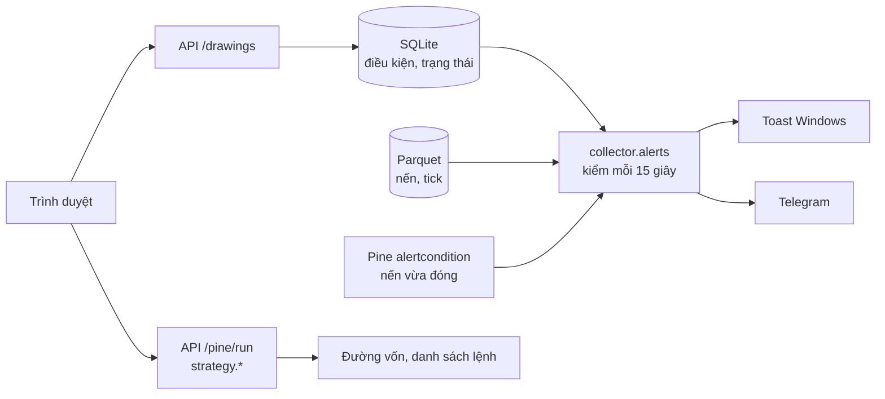
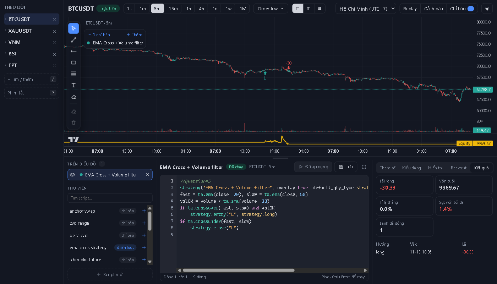

# Cảnh báo, công cụ vẽ, replay và backtest

Phase 9. Trạng thái: xong. Còn việc kiểm chứng kênh thông báo và các điều kiện orderflow.

## Sơ đồ

## Cảnh báo

Tiến trình nền `python -m collector.alerts` (có trong `run-collectors.ps1`) kiểm mỗi 15 giây, độc lập với trình duyệt và server web. Điều kiện: giá chạm mức, giá cắt mức, `alertcondition` của Pine ở nến vừa đóng. Trạng thái nằm trong SQLite nên khởi động lại không bắn lại và không bỏ sót. Nếu không kênh nào gửi được, nó thử lại tối đa 3 lượt rồi ghi nhận với `sent` rỗng. Kênh: toast Windows và Telegram (cần `TELEGRAM_BOT_TOKEN` và `TELEGRAM_CHAT_ID` trong `.env`).

Chưa kiểm bằng mắt: lệnh toast trả mã thành công nhưng chưa xác nhận thông báo hiện trên màn hình. Telegram chưa thử với khoá thật, chỉ có test với máy chủ giả.

## Cảnh báo collector im lặng

`collector/watchdog.py` chạy trong tiến trình `collector.alerts`, kiểm mỗi 60 giây và gửi qua cùng kênh với cảnh báo giá (toast Windows, Telegram). Mốc ghi cuối là thời điểm sửa của file con mới nhất của `ticks` và `book` hôm nay hoặc hôm qua. Collector ghi một file con mỗi 60 giây, nên hơn 5 phút không có file mới nghĩa là tiến trình đã dừng, kẹt hoặc mất mạng. Báo một lần khi bắt đầu im, nhắc lại mỗi 30 phút nếu vẫn im, báo một lần khi phục hồi.

Giới hạn: chỉ theo dõi symbol crypto đang được ghi (cặp có file trong 7 ngày gần đây); cổ phiếu VN chỉ ghi trong giờ giao dịch nên chưa theo dõi. File đã gộp bởi `hotmerge` không tính, vì việc gộp làm mới mtime dù collector đã chết. Nếu cả máy tắt hoặc ngủ thì tiến trình cảnh báo cũng dừng, nên không có tin nào được gửi. Biến môi trường: `WATCHDOG_SILENCE_S` (300), `WATCHDOG_REMIND_S` (1800), `WATCHDOG_ENABLED=0` để tắt, hoặc cờ `--no-watchdog`.

## Công cụ vẽ

Đường xu hướng, đường ngang, hộp, Fibonacci, văn bản. Lưu trong SQLite theo symbol. Điểm neo là (thời gian, giá) nên đúng ở mọi khung. Bản vẽ dùng chung cho mọi ô của symbol đó, chưa có layout đặt tên. Chưa kéo sửa điểm neo.

Xoá hình có bốn cách: (1) ở chế độ Trỏ, bấm vào hình để chọn (hình sáng lên, hiện điểm neo) rồi nhấn `Delete` hoặc `Backspace`, `Esc` để bỏ chọn; (2) nút "Xoá hình đang chọn" trên thanh vẽ; (3) công cụ Xoá, bấm vào hình; (4) nút xoá mọi hình của symbol. Hình vừa vẽ xong được chọn sẵn, nên xoá ngay được nếu vẽ nhầm.

## Bar replay

Phát lại từng nến: tiến, lùi, phát, tạm dừng, 1 đến 30 nến mỗi giây, thanh trượt, trên 1000 nến đã tải. Không phát lại tick, và lệnh khớp trực tiếp bị bỏ qua khi đang phát lại. Thoát replay thì nạp lại nến mới nhất.

## Backtest

Dùng engine Pine ([08-pine-engine.md](08-pine-engine.md)) với vốn, phí, trượt giá tính theo tick và khoảng ngày. Lệnh đặt ở nến i khớp ở giá mở của nến i+1, một vị thế ròng, phí theo phần trăm. Mỗi lần tối đa 5000 nến. Phí và trượt giá được kiểm bằng mô phỏng tay, khớp 1e-9 trên 600 nến.

### Dữ liệu lịch sử cho backtest

Ngày bắt đầu lấy từ kho `data.binance.vision`, kiểm tra 14/11/2026.

| Dữ liệu | Symbol | Từ ngày | Dùng cho |
|---|---|---|---|
| `aggTrades` (có cờ mua/bán) | BTCUSDT | 31/12/2019 | Footprint, delta, CVD, volume profile |
| `aggTrades` | XAUUSDT | 11/12/2025 | Như trên, mẫu khoảng 11 tháng |
| `trades` (từng lệnh) | BTCUSDT | 08/09/2019 | Khi cần chi tiết hơn aggTrades |
| Nến 1 phút | BTCUSDT | 31/12/2019 | Giá, volume |
| `metrics` (open interest, long/short, taker, 5 phút) | BTCUSDT | 01/09/2020 | Bộ lọc vị thế |
| `bookDepth` (6 dải, cách 30 giây) | BTCUSDT | 01/01/2023 | Heatmap thô |
| `bookDepth` | XAUUSDT | 11/12/2025 | Heatmap thô |
| `bookTicker` | BTCUSDT | 16/05/2023, ngừng 30/03/2024 | Spread |

Không có miễn phí: sổ lệnh từng mức giá trong quá khứ, lịch sử open interest options Deribit, tick cổ phiếu VN, GC1! trước ngày trả phí.

### Giới hạn phải ghi trên báo cáo backtest

- `aggTrades` gộp lệnh cùng giá, cùng thời điểm, nên không mô phỏng được khớp từng lệnh.
- Volume và orderflow là của Binance, không phải toàn thị trường.
- Backtest không mô phỏng vị trí hàng đợi và độ trễ. Tín hiệu từ heatmap đẹp hơn thực tế vì lệnh giả.
- XAUUSDT chỉ có khoảng 11 tháng, độ tin cậy thấp.
- Delta, heatmap và GEX chỉ có từ lúc bắt đầu thu thập (tick BTC và XAU từ 2026-11-14 sau khi tải bù), nên backtest dựa vào chúng chỉ đúng trong khoảng đó.
- Mọi tín hiệu chỉ dùng dữ liệu có `ts` không muộn hơn lúc nến đóng.

## Nghiệm thu

- Tạo cảnh báo, đóng trình duyệt, collector vẫn gửi thông báo khi điều kiện đúng. Đã qua ở mức tiến trình. Kênh thông báo chưa kiểm bằng mắt.
- Phí và trượt giá của backtest khớp mô phỏng tay. Đã qua.

## Việc còn mở

- [ ] Bạn xác nhận toast Windows có hiện lên màn hình.
- [ ] Thêm `TELEGRAM_BOT_TOKEN` và `TELEGRAM_CHAT_ID` vào `.env`, thử một cảnh báo thật.
- [x] Cảnh báo khi collector im lặng hơn 5 phút (2026-11-15). Cần khởi động lại `run-collectors.ps1` để tiến trình `alerts` nạp mã mới. Chưa thử gửi thật qua toast và Telegram.
- [ ] Cảnh báo theo điều kiện orderflow (delta, CVD, imbalance, GEX flip). Hiện chỉ có giá, cắt mức và `alertcondition` của Pine.
- [ ] `strategy.exit` với stop và limit, nhiều lệnh cùng lúc, pyramiding, trượt giá theo thanh khoản.
- [ ] Sửa điểm neo của hình vẽ.
- [ ] Bar replay theo tick, không chỉ theo nến.
- [ ] Lưu layout nhiều ô vào SQLite và đặt tên được: xem [02-chart-ui.md](02-chart-ui.md).
