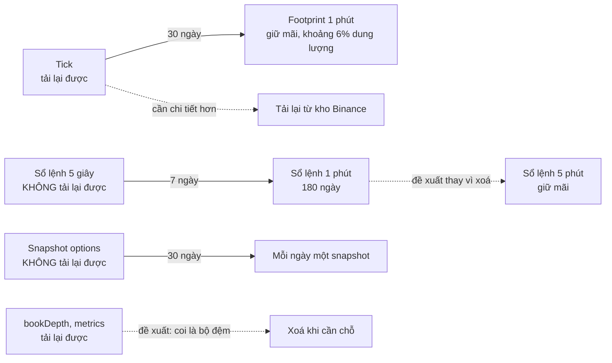

# Tối ưu bộ nhớ và dữ liệu

Cập nhật 2026-11-15. Trạng thái: một phần đã làm (bộ nhớ của server), phần còn lại là phương án chờ quyết định.

Mục tiêu có hai vế. Bộ nhớ: không bao giờ để một tiến trình làm Windows chạm trần commit, như sáng 15/11 khi server giữ 27,9 GB. Dữ liệu: chỉ giữ lâu thứ không tải lại được, còn thứ tải lại được miễn phí thì giữ gọn và có thể bỏ.

## Nguyên tắc

1. **Phân biệt dữ liệu tải lại được và không.** Tick, nến 1 phút, `bookDepth` và `metrics` của Binance tải lại được từ `data.binance.vision` (BTC từ 2019, XAUUSDT từ 11/12/2025), nên bản trên đĩa chỉ là bộ đệm để khỏi chờ tải. Sổ lệnh từng mức giá, snapshot options Deribit và sổ lệnh VN100 chỉ có từ lúc collector ghi, không lấy lại được. Chỉ nhóm thứ hai cần sao lưu và giữ cẩn thận.
2. **Đặt trần cứng cho mọi thứ có thể phình**, rồi mới tìm nguyên nhân. Trần chặn thiệt hại bất kể nguyên nhân.
3. **Đo trước khi sửa.** Mọi con số dưới đây là số đo, hoặc ghi rõ "ước tính".

## Sơ đồ phân tầng dữ liệu

Nét liền là chính sách đang chạy (`config/retention.toml`), nét đứt là đề xuất.

## Bộ nhớ

Hiện trạng đo ngày 2026-11-15: các collector tổng khoảng 400 MB (`live_book` 100, `hotmerge` 125, `live_trades` 80, còn lại 30 đến 45 mỗi cái), server 80 đến 400 MB, vite 180 MB. Server mới trong bài thử nặng không vượt 376 MB. Lần phình 27,9 GB chưa tái hiện được và chưa biết nguyên nhân (xem [01](01-collector-storage.md)).

| Biện pháp | Lợi ích | Trạng thái |
|---|---|---|
| Một instance DuckDB dùng chung cho truy vấn đọc, trần 1 GB, 4 luồng, tràn ra `DATA_DIR\tmp` | Đỉnh 221 MB thay vì 376 MB trong cùng bài thử | **Đã làm** |
| `memguard`: đo bộ nhớ cam kết mỗi 30 giây, ghi cảnh báo kèm 5 đường dẫn gọi nhiều nhất, tự thoát ở 3 GB, `dev.ps1` tự khởi động lại | Giới hạn thiệt hại ở 3 GB thay vì 28 GB | **Đã làm** |
| `/health` trả `private_mb`, `threads`, `limit_mb` | Theo dõi từ ngoài | **Đã làm** |
| Trần DuckDB cho đường ghi và collector (`hotmerge`, `compact`, `backfill`, ghi file con): `store.work_conn()`, 512 MB và 2 luồng (`DUCKDB_WORK_MEMORY_LIMIT`, `DUCKDB_WORK_THREADS`), tràn ra `DATA_DIR\tmp`. Đường đọc của `live_trades` dùng `store.query_conn()` | Gom nén file lớn không bao giờ chiếm tới 80% RAM. Chưa đo mức giảm bộ nhớ của `hotmerge` (125 MB) | **Đã làm** (2026-11-15). Cần khởi động lại `run-collectors.ps1` để các collector nạp mã mới |
| Giới hạn số yêu cầu nặng chạy đồng thời (Pine, footprint, profile, heatmap, bong bóng, iceberg): `server/limits.py`, mặc định 3 (`HEAVY_CONCURRENCY`), chờ tối đa 60 giây rồi trả 503 kèm `Retry-After` | Chặn đỉnh bộ nhớ khi giao diện bắn nhiều yêu cầu cùng lúc (đổi khung với nhiều chỉ báo). `/health` trả `heavy_active`, `heavy_peak` | **Đã làm** (2026-11-15) |
| Bộ nhớ đệm kết quả Pine theo (script, symbol, khung, tham số, nến cuối) có trần theo byte | Giảm CPU, nhưng tốn bộ nhớ: phải đặt trần, ví dụ 200 MB | Đề xuất. Xem TODO |
| Chế độ chẩn đoán `SERVER_MEM_DIAG=1`: bật `tracemalloc` khi khởi động, và khi bộ nhớ vượt nửa trần (hoặc ngay trước khi thoát vì vượt trần) ghi báo cáo: nơi cấp phát nhiều nhất, loại đối tượng Python nhiều nhất, luồng theo loại | Tìm nguyên nhân thật của lần phình 28 GB. Chỉ thấy phần Python cấp phát, không thấy DuckDB. Làm chậm server, chỉ bật khi đang tìm nguyên nhân | **Đã làm** (2026-11-15) |
| Chạy thử dài với yêu cầu luân phiên giống giao diện: `python scripts/soak_server.py --minutes 360`, lấy mẫu `/health` mỗi phút, báo hệ số tăng MB mỗi giờ | Biết server có phình theo thời gian không | Script đã có. Đã chạy thử 30 phút, xem mục Kết quả chạy thử dài. **Cần chạy 6 giờ trước khi coi vấn đề đã đóng** |

Cách đo: `curl http://127.0.0.1:8000/health` cho `private_mb` của server. Bộ nhớ cam kết toàn máy: `Get-Counter '\Memory\Committed Bytes','\Memory\Commit Limit'`. Cần theo dõi commit, không chỉ RAM thật, vì Windows từ chối cấp phát khi commit chạm trần.

## Dữ liệu trên đĩa

Hiện trạng: `C:\tv-data` 3,4 GB, trong đó `ticks` 2,9 GB (BTCUSDT 366 ngày 2,4 GB, XAUUSDT 340 ngày 0,5 GB), `bookdepth` 0,24 GB, `bars` 0,06 GB. Ổ C còn 240 GB.

| Biện pháp | Lợi ích | Trạng thái |
|---|---|---|
| Gom tick quá 30 ngày thành footprint 1 phút (`retention.toml`) | `ticks` từ 2,9 GB còn 0,22 GB cộng 0,16 GB footprint (số đo thật sau khi chạy) | Đã có, **đã chạy ngày 2026-11-15** theo quyết định bên dưới. Kết quả đo ở mục Kết quả gom nén |
| Giữ tick 365 ngày thay vì 30 | Giữ footprint dưới 1 phút cho cả năm. Tốn thêm khoảng 2,2 GB so với gom nén ở thời điểm này (2,9 GB so với 0,7 GB), và khoảng 3 GB mỗi năm chạy tiếp cho hai symbol | Cần quyết định |
| Bỏ cột `id` của tick sau khi đã loại trùng, giá số nguyên, `qty` float32 | Số đo một ngày BTC: 6,65 MB còn 5,22 MB, giảm 21% | Đề xuất cho ngày đã gom, vì `id` chỉ cần để loại trùng |
| Coi `bookDepth` và `metrics` là bộ đệm: xoá cũ hơn 90 ngày khi cần chỗ, tải lại khi dùng | Giải phóng 0,24 GB và 0,3 GB mỗi năm | Đề xuất |
| Sổ lệnh quá 180 ngày: gom thành 5 phút giữ mãi thay vì xoá | Giữ lịch sử heatmap thô với khoảng 0,13 GB mỗi năm (ước tính, chưa đo) | Đề xuất. Sổ lệnh không tải lại được nên xoá là mất vĩnh viễn |
| Cảnh báo khi đĩa thấp: trần `max_data_gb` đã có, thêm cảnh báo ở 80% trần hoặc ổ còn dưới 10 GB, qua kênh của watchdog | Không để ổ đầy làm collector ngừng ghi | Đề xuất |
| Dọn `DATA_DIR\tmp` khi khởi động, xoay vòng `logs` | Tránh file tràn của DuckDB và log tích tụ | Đề xuất. Hiện 1 MB, chưa gấp |
| Sao lưu chỉ nhóm không tải lại được: `book`, `options`, `vn_book`, `app.sqlite` | Sao lưu vài chục MB mỗi tuần thay vì cả 3,4 GB | Đề xuất. Xem TODO |

Ước tính mỗi năm khi chạy 24/7 theo chính sách mặc định: khoảng 1,3 GB (yên tĩnh, đã sửa theo số đo footprint) đến 2,5 GB (biến động mạnh, chưa đo); không gom nén thì khoảng 11 GB và 22 đến 33 GB (xem [01](01-collector-storage.md)).

## Kết quả gom nén (2026-11-15)

Chạy `python -m collector.compact` sau khi chạy thử `--dry-run`. Mất khoảng 8 phút, gom 644 ngày tick của BTCUSDT và XAUUSDT, 0 cảnh báo, giải phóng 2,65 GB.

| | Trước | Sau |
|---|---|---|
| `ticks` | 2.910 MB | 223 MB (chỉ 30 ngày gần nhất, từ 2026-10-16) |
| `footprint_1m` | 0 | 159 MB (335 ngày BTC, từ 2025-11-15) |
| Cả `DATA_DIR` trừ `.venv` và `web-deps` | khoảng 3,4 GB | 714 MB |

Đã kiểm `/api/footprint` ở khung 1 phút cho một ngày đã gom (2026-03-10) và một ngày còn tick (2026-11-14): cả hai trả 200 và có dòng dữ liệu, nên biểu đồ vẫn dựng được footprint từ ngày cũ.

Số đo thật tốt hơn ước tính: footprint chỉ khoảng 0,47 MB mỗi ngày cho cả hai symbol, tức 0,17 GB mỗi năm, thay vì 1,24 MB mỗi ngày (0,45 GB mỗi năm) suy ra từ một ngày mẫu. Vì vậy ước tính mỗi năm theo chính sách giữ dữ liệu giảm từ 1,6 GB xuống khoảng 1,3 GB. Phần ngày biến động mạnh (khoảng 2,5 GB) chưa đo.

## Quyết định

**Đã chọn (2026-11-15): để gom nén chạy, giữ `full_days = 30`.** Tick quá 30 ngày thành footprint 1 phút rồi xoá tick. Lý do bên dưới, giữ lại để biết cách đổi ý.

**Giữ tick một năm hay để gom nén chạy?** Khuyến nghị đã nhận: để gom nén chạy. Tick BTCUSDT từ 2019 và XAUUSDT từ 12/2025 tải lại được miễn phí trong khoảng 30 phút cho một năm, nên gom nén không làm mất gì mà bạn không lấy lại được. Giữ tick đầy đủ chỉ đáng khi bạn thường xuyên cần footprint dưới 1 phút cho cả năm. Nếu chọn giữ, đặt `full_days = 400` trong `config/retention.toml` **trước** khi chạy lại `run-collectors.ps1` hoặc `collector.daily`, vì cả hai đều gom nén.

Một việc phụ thuộc quyết định này: sau gom nén, footprint dưới 1 phút của ngày cũ chỉ dựng lại được bằng cách tải lại file ngày.

## Việc còn mở

- [x] Quyết định `full_days`: giữ 30, để gom nén chạy (2026-11-15).
- [x] `store.work_conn()` và áp trần cho `hotmerge`, `compact`, `backfill` (2026-11-15).
- [x] Giới hạn yêu cầu nặng của server (`server/limits.py`).
- [x] Chế độ chẩn đoán `SERVER_MEM_DIAG`.
- [ ] Chạy thử 6 giờ (`scripts/soak_server.py --minutes 360`) và đọc log `server.mem` để biết server có phình không.
- [ ] Đo bộ nhớ của `hotmerge` trước và sau khi áp trần.
- [ ] Gom sổ lệnh quá 180 ngày thành 5 phút thay vì xoá. Đo dung lượng thật trước khi chọn.
- [ ] Bỏ cột `id` của tick đã gom, và coi `bookDepth`, `metrics` là bộ đệm.
- [ ] Cảnh báo đĩa thấp trong watchdog.
- [ ] Sao lưu nhóm dữ liệu không tải lại được.
