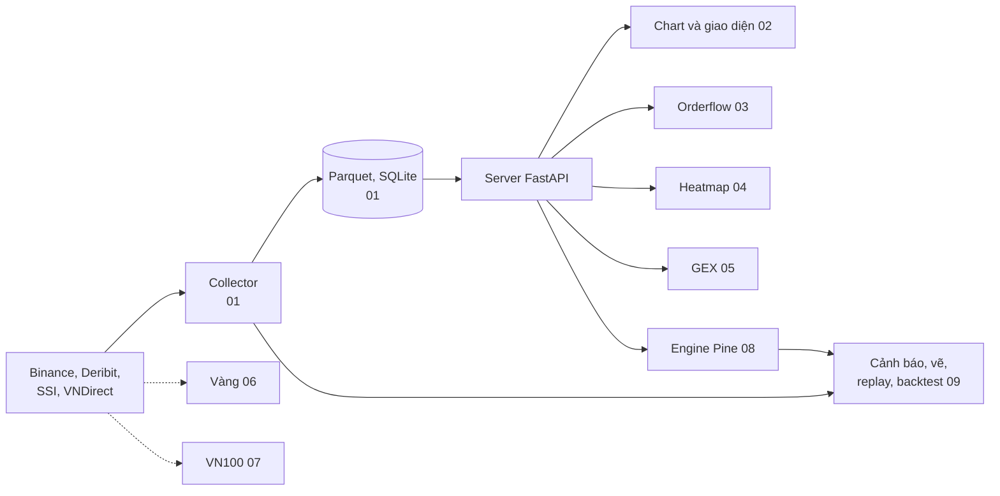

# Kế hoạch dự án

Cập nhật 2026-11-15. Mỗi tính năng chính có một file. Mỗi file ghi mục tiêu, sơ đồ, quyết định, số đo, nghiệm thu và việc còn mở. Việc còn mở chỉ nằm trong file của tính năng đó, không có bản thứ hai ở nơi khác.

Sơ đồ tương tác của toàn hệ thống: mở [`plan.html`](plan.html) bằng trình duyệt. Trang chạy offline, có tab cho từng tính năng. Dựng lại bằng `cd plan-viewer && node build.mjs`.

## Tổng quan

## Tính năng và trạng thái

| File | Tính năng | Phase | Trạng thái |
|---|---|---|---|
| [01-collector-storage.md](01-collector-storage.md) | Thu thập và lưu trữ | 0, 1 | Xong. Vận hành còn việc mở |
| [02-chart-ui.md](02-chart-ui.md) | Biểu đồ và giao diện | 2, UX | Xong |
| [03-orderflow.md](03-orderflow.md) | Footprint, delta, CVD, profile | 3 | Xong, trừ profile theo phiên |
| [04-heatmap.md](04-heatmap.md) | Heatmap thanh khoản | 4 | Xong, chưa đo thời gian vẽ |
| [05-gex.md](05-gex.md) | GEX BTC | 5 | Xong |
| [06-gold.md](06-gold.md) | Vàng | 6 | 6A xong. 6B, 6C tuỳ chọn, chưa làm |
| [07-vn100.md](07-vn100.md) | Cổ phiếu VN100 | 7 | Chưa đo phiên giao dịch thật |
| [08-pine-engine.md](08-pine-engine.md) | Engine Pine | 8 | Xong, chưa đối chiếu TradingView |
| [09-alerts-drawing-backtest.md](09-alerts-drawing-backtest.md) | Cảnh báo, vẽ, replay, backtest | 9 | Xong. Kênh thông báo chưa kiểm bằng mắt |

Ghi chú kỹ thuật theo thời gian (số đo gốc, lỗi đã sửa): [engineering-notes.md](engineering-notes.md). Tài liệu gốc, giữ để tra cứu: [archive/spec-original.md](archive/spec-original.md) là đặc tả từng phase cho Claude Code, và [archive/research-initial.md](archive/research-initial.md) là bản nghiên cứu đầu tiên, nhiều nhận định đã được sửa. Khi mâu thuẫn, các file `01` đến `09` là bản đúng.

## Thứ tự nên làm

1. **Giữ collector chạy liên tục.** Dữ liệu sổ lệnh và snapshot options chỉ tích luỹ khi máy chạy, và không lấy lại được miễn phí. Lên lịch bằng Task Scheduler, thêm cảnh báo khi collector im lặng và sao lưu `C:\tv-data`. Xem [01](01-collector-storage.md).
2. **Đo phiên VN100 ngày Thứ Hai 16/11.** Việc này chặn nghiệm thu Phase 7. Xem [07](07-vn100.md).
3. **Kiểm kênh thông báo.** Toast và Telegram chưa thử thật. Xem [09](09-alerts-drawing-backtest.md).
4. **Đối chiếu engine Pine với TradingView** và thêm cache kết quả. Xem [08](08-pine-engine.md).
5. **Hạng mục nâng cao** của orderflow, heatmap và giao diện: [03](03-orderflow.md), [04](04-heatmap.md), [02](02-chart-ui.md).

## Việc bị chặn bởi điều kiện bên ngoài

| Việc | Cần | File |
|---|---|---|
| Đo sổ lệnh VN100 | Phiên giao dịch, Thứ Hai 16/11 | [07](07-vn100.md) |
| GC1! và options vàng | Khoá Databento và tiền | [06](06-gold.md) |
| Heatmap lịch sử trước ngày ghi | Tardis, trả phí | [04](04-heatmap.md) |
| Ký hiệu Deep Trades, iceberg chính xác | Dữ liệu MBO, Binance không có | [03](03-orderflow.md) |
| Telegram | Token bot của bạn | [09](09-alerts-drawing-backtest.md) |
